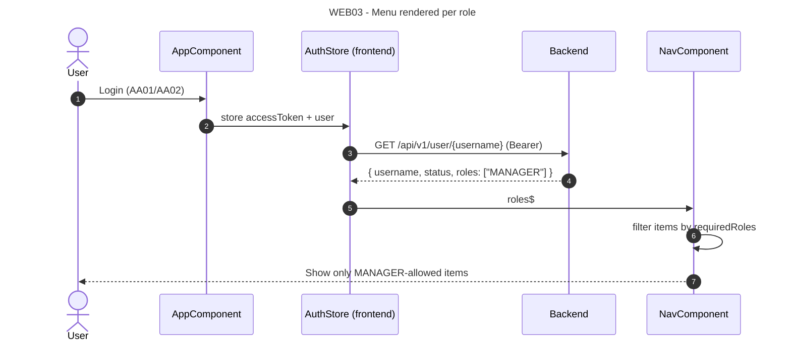
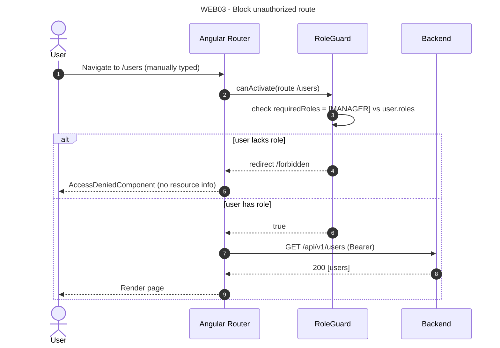
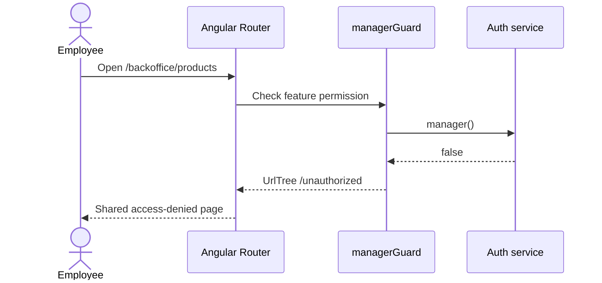

# WEB03 — Role-Based Navigation

> **Documentation scope (2026-11-06):** Section 1 preserves the original requirements and proposed design baseline. Section 2 records the implementation inspected in this repository and takes precedence for current paths, roles, flows and completion claims. Differences are documented as remaining work or implementation departures, not as changes to the original specification.

## 1. Requirements Engineering

### 1.1. User Story Description
As an authenticated System User, I want menus and navigation appropriate to my role, so that I can find the operations available to me.

### 1.2. Customer Specifications and Clarifications

#### From the specification document
> Extracted from *PART IV – Sprint 2 – User Stories* (WEB03, p. 5) and *Table 1* (pp. 11–12).

- **Dynamic menu:** Menu options rendered dynamically based on authenticated user's roles and permissions.
- **Route protection:** Navigation to unauthorized sections must be **prevented even if manually typed in the URL**.
- **Access denied UX:** Appropriate access-denied message shown **without revealing protected information**.
- **Table 1 permissions:** Base-role permissions defined in the S2 Table 1 (`Guest`, `Administrator`, `LaPizza Manager`, `Restaurant Staff`, `Customer`). Note: "Administrator" in Table 1 is a **functional designation** of the `MANAGER` role per Clarification #24, not a separate role; "Restaurant Staff" maps to `EMPLOYEE`.
- **Multi-role:** Users with more than one role may access functionality granted by those roles, subject to data-ownership/confidentiality restrictions.
- **Immediate effect:** Changes to roles or account status must be reflected **before further protected operations are accepted** (guard reads current state, not stale token claims).
- **Hiding ≠ security:** Hiding a menu option must be complemented by server-side checks whenever the functionality is requested.

#### From project clarifications
- **Clarification #24 §3.2:** `RolesGuard` re-reads roles from the repository (not only JWT claims) so role revocation takes effect immediately.
- **Clarification #25:** Restaurant Staff == Employee; `UserRole = {MANAGER, EMPLOYEE, CUSTOMER}`.
- **Guest** is automatic for unauthenticated visitors; not assigned by an Administrator.
- **Table 1 mapping to system roles:** `Guest → anonymous`, `Administrator → MANAGER (functional designation for user/role admin)`, `LaPizza Manager → MANAGER`, `Restaurant Staff → EMPLOYEE`, `Customer → CUSTOMER`.

### 1.3. Acceptance Criteria

- **AC1 — Dynamic menu:** Nav items are computed from the authenticated user's `roles[]` returned by the backend.
- **AC2 — Route guards:** Unauthorized routes are blocked by an Angular route guard; direct URL typing is denied with a clear message.
- **AC3 — Access denied:** Message shown without disclosing resource existence or content.
- **AC4 — Table 1 mapping:** Permissions follow the base-role table (see §1.2); no implicit privilege escalation via multi-role.
- **AC5 — Immediate revocation:** After a role change or deactivation on the server, the next protected operation is rejected (backend is authoritative; frontend refreshes session data on 401/403).
- **AC6 — Defence in depth:** Hiding a menu item is never the only defence; the backend `RolesGuard` enforces the same rule.

### 1.4. Found out Dependencies

- **Preceding:** WEB01, WEB02, AA01/AA02 (identity + roles resolved), AA03 (internal role resolution), AA05 (authorization enforcement).
- **Succeeding:** Every protected feature page (WEB05, WEB06, WEB07).

### 1.5. Input and Output Data

**Inputs:**
- `JWT` claims: `sub`, `email`, `roles[]` — but the frontend uses the **current backend user** (`GET /api/v1/user/:username` or a `/me` endpoint if present) to reflect live changes.
- Route metadata: `data: { roles: UserRole[] }`.

**Outputs:**
- Rendered menu items per role.
- Route guard decisions.
- Access-denied view.

### 1.6. System Sequence Diagram (SSD)

#### 1.6.1. Menu Render by Role

#### 1.6.2. Direct URL to Unauthorized Section

### 1.7. Other Relevant Remarks

- **Frontend is not authoritative:** The `RoleGuard` is a UX shortcut; the backend `RolesGuard`/`StatusGuard` (§13.1 of KB) is the real enforcement.
- **`/forbidden` route:** Must not leak the reason (e.g., don't distinguish "user does not exist" vs "you lack role").
- **Menu source of truth:** a single `NAV_ITEMS` constant (or config file) with `{ labelKey, path, requiredRoles }`. Do not scatter role checks in templates.

## 2. Current Implementation — 2026-11-06

### 2.1. Implemented role model and route permissions

The code defines four distinct roles: `ADMINISTRATOR`, `MANAGER`, `EMPLOYEE`, and `CUSTOMER`. In this implementation, Administrator is a separate role and does not automatically inherit Manager permissions. This differs from the functional-designation mapping retained in the original baseline above.

| Route/operation | Frontend authorization |
|---|---|
| `/`, `/menu`, `/order`, `/login`, `/register` | Public storefront routes; `/order` is a cart draft |
| `/account` | `customerGuard` checks an ACTIVE authenticated user; it does not explicitly require CUSTOMER |
| `/backoffice` shell and `/backoffice/profile` | ACTIVE user with ADMINISTRATOR, MANAGER or EMPLOYEE |
| `/backoffice/products`, categories, components, sizes, allergens, configurations, pizzas | MANAGER, inside the guarded backoffice shell |
| `/backoffice/orders`, `/backoffice/kitchen` | MANAGER or EMPLOYEE; kitchen is a placeholder |
| `/backoffice/users` | ADMINISTRATOR or MANAGER; role/status mutation controls are Administrator-only |
| `/status`, `/unauthorized` | Public |

The actual management paths are `/backoffice/product-categories`, `/backoffice/pizza-components`, `/backoffice/pizza-sizes`, `/backoffice/allergens`, `/backoffice/component-configurations`, and `/backoffice/pizzas`. `/backoffice/product-types` redirects to categories and `/backoffice/access` redirects to `/unauthorized`.

### 2.2. Menu, guards and denied access

`Auth` computes role predicates from the backend login/registration response's `user.roles`. The backoffice keeps a `links` array and `canSeeLink()` policy; route protection uses explicit `staffGuard`, `managerGuard`, `restaurantGuard`, and `invitationGuard` functions rather than generic role metadata. The default backoffice destination is products for Managers, users for Administrators, and orders for Employees.

An unauthenticated backoffice deep link redirects to `/backoffice/login?returnUrl=...`. An authenticated user failing a feature guard is directed to the shared public `/unauthorized` page. All API `403` responses also navigate there, including failures on public API calls. This page displays a generic explanation without protected content and retains the stored session.

### 2.3. Authority and limitations

Backend authorization remains authoritative on every request. The frontend uses its stored user snapshot and does not fetch `/me` or refresh roles automatically on navigation or `403`. Consequently, changes made by another administrator may leave menu visibility stale until a new session/user update; the next protected API request still uses current server-side roles. An authenticated protected-API `401` clears the local session and returns to the appropriate login page with a return path.

**Source:** [backoffice routes](../../../frontend/src/app/backoffice/backoffice.routes.ts), [backoffice guards](../../../frontend/src/app/backoffice/core/auth/guards.ts), [customer guard](../../../frontend/src/app/frontoffice/core/auth/guards.ts), [navigation policy](../../../frontend/src/app/backoffice/shared_components/layout/backoffice.ts), [shared auth/interceptor](../../../frontend/src/app/shared_components/core/auth/auth.ts).

**Existing verification:** [role-access matrix](../../../frontend/e2e/role-access.spec.ts), [authorization responses](../../../frontend/e2e/authorization.spec.ts), and [backoffice flows](../../../frontend/e2e/backoffice/backoffice.spec.ts). These cover permitted/denied routes, multi-role combinations, session handling and role-dependent controls with mocked API responses.
