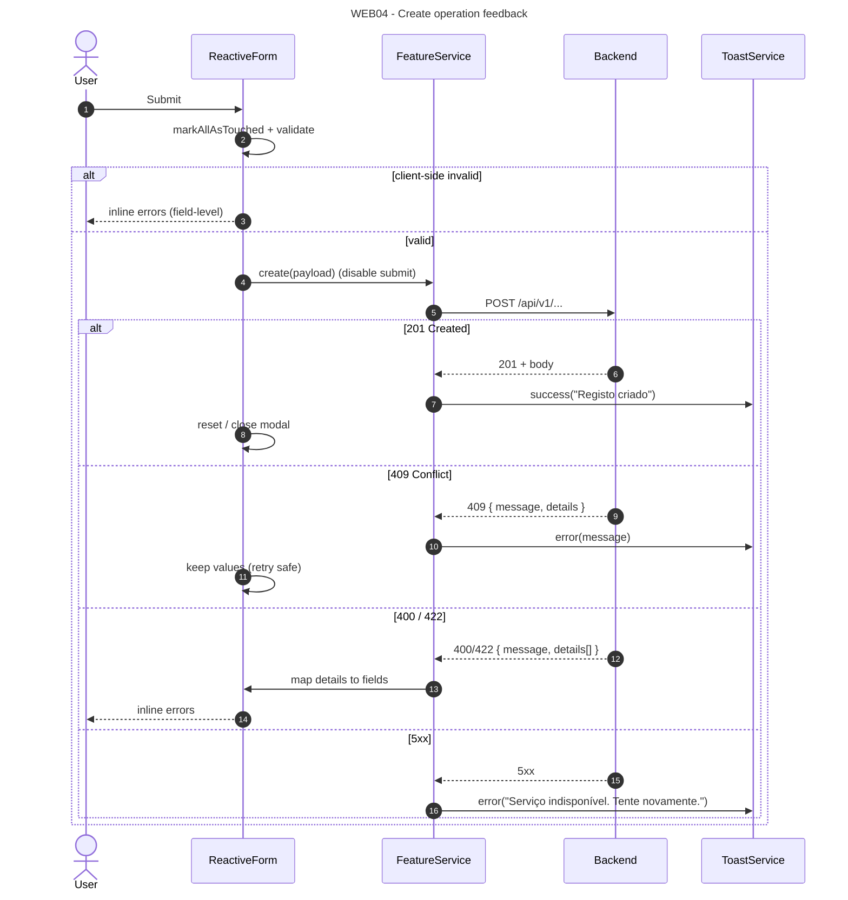
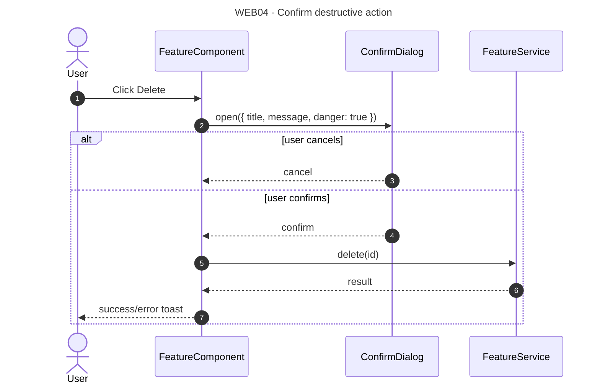

# WEB04 — User Feedback and Validation

## 1. Requirements Engineering

### 1.1. User Story Description
As a System User, I want clear feedback for actions and failures, so that I can understand results and correct invalid input.

### 1.2. Customer Specifications and Clarifications

#### From the specification document
> Extracted from *PART IV – Sprint 2 – User Stories* (WEB04, p. 6).

- **Success messages:** confirm relevant actions (save, update, deactivate).
- **Validation errors:** identify affected fields and explain how to correct input.
- **Loading indicators:** while fetching/processing.
- **Failures:** clear language, **no internal system details or sensitive information**.
- **Honesty:** unsuccessful operation must not be presented as completed; preserve user input where appropriate.
- **Confirmation:** significant-consequence actions require confirmation before completion.
- **Idempotency in the UI:** repeated submissions while in progress are prevented; connection failures allow recovery/retry safely.

#### From project clarifications
- **Clarification #23 §1.1:** Error messages explain reason and, when relevant, link to dependencies (e.g., "cannot delete category 'Pizzas' because it is referenced by PRD-PIZZA-MARG").
- **Clarification #23 §6.1:** Concurrent edit conflict → `409 Conflict` with re-read before re-submit.
- **Backend error envelope** (KB §25.1): `{ timestamp, status, error, message, details? }`.

### 1.3. Acceptance Criteria

- **AC1 — Success feedback:** A visible success message after each mutating operation (create/update/delete/activate).
- **AC2 — Field-level validation:** Client-side validation identifies the field and the correction; server-side validation failures map back to the field when possible.
- **AC3 — Loading state:** Buttons/spinners disabled or in loading state during request; prevents double submit.
- **AC4 — Failure clarity:** User-facing error messages are human-readable; stack traces, SQL, and internal IDs are never shown.
- **AC5 — Failure honesty:** A failed operation is not shown as success; input is preserved so the user can correct and retry.
- **AC6 — Confirmation:** Destructive/significant actions require an explicit confirmation dialog.
- **AC7 — Retry safety:** After network failure, the user can retry without creating duplicates (backend idempotency or explicit user re-submit; UI must not auto-duplicate).
- **AC8 — Global error mapping:** HTTP `400/401/403/404/409/422/502/503` are mapped to distinct user messages via a shared error interceptor.

### 1.4. Found out Dependencies

- **Preceding:** WEB01 (HTTP layer), WEB02 (message component), WEB03 (role-aware messages).
- **Succeeding:** All Sprint 1 management pages (WEB05), WEB06, WEB07.

### 1.5. Input and Output Data

**Inputs:**
- HTTP response or error from backend.
- Form state + form validation errors (Angular reactive forms).

**Outputs:**
- Toast/snackbar for success/error.
- Inline field errors.
- Confirmation dialog.
- Retry affordance.

### 1.6. System Sequence Diagram (SSD)

#### 1.6.1. Create Operation Success & Failure

#### 1.6.2. Destructive Action Confirmation

### 1.7. Other Relevant Remarks

- **Central error interceptor** (`ErrorInterceptor`) normalises backend envelope `{ message, details? }`; no feature component parses raw error strings.
- **Never** render `err.error.stack` or SQL. Log to console only in dev.
- **Form state preservation** also applies on language change (WEB02) and on retry after validation failure.
- **Confirmation dialogs** required for: category/allergen/component-type/size deletion, product deactivation, stock adjustment (large negative), kitchen configuration activation (deactivates the previous one), planning execution, etc.