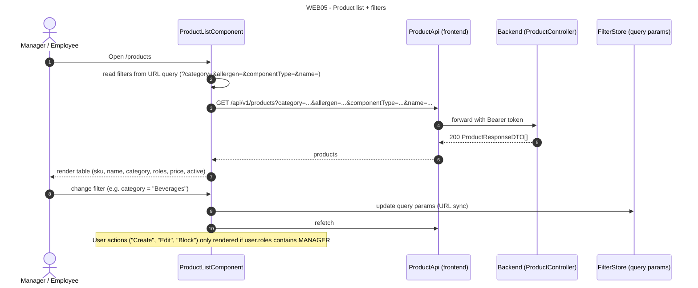
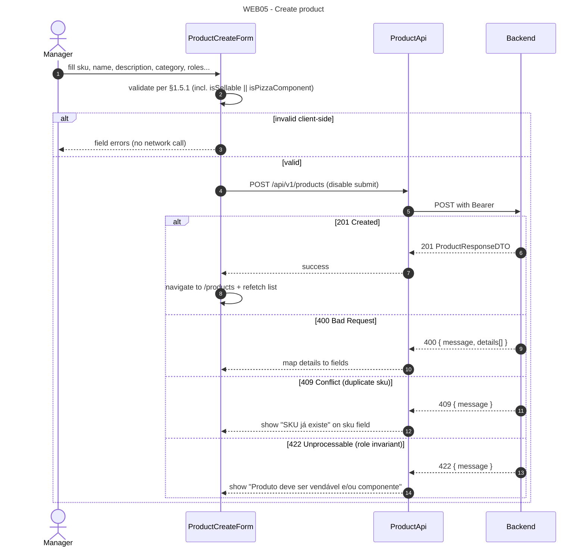
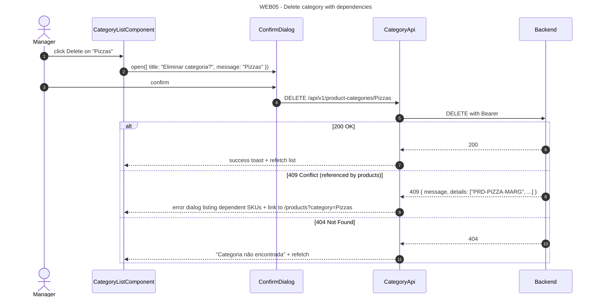
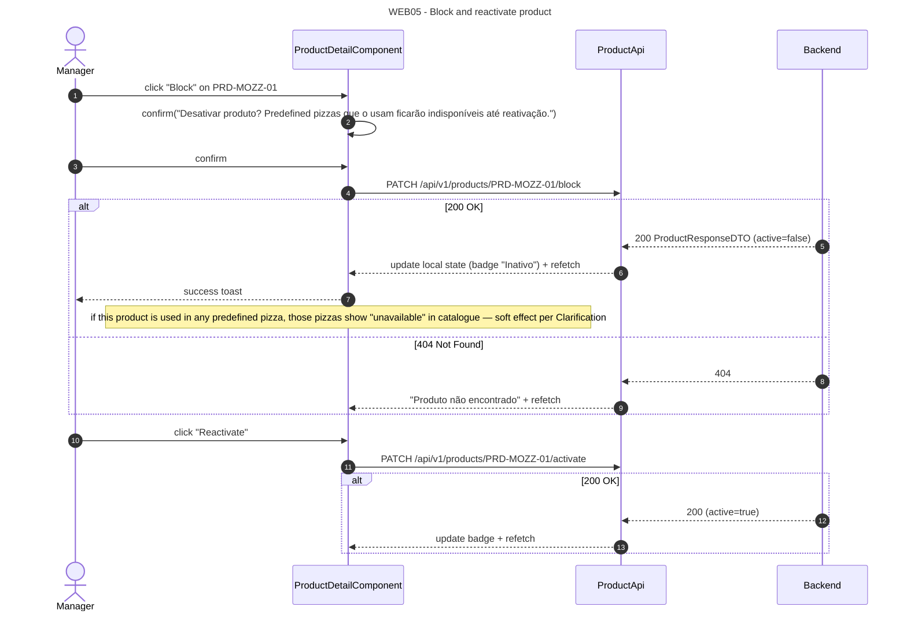
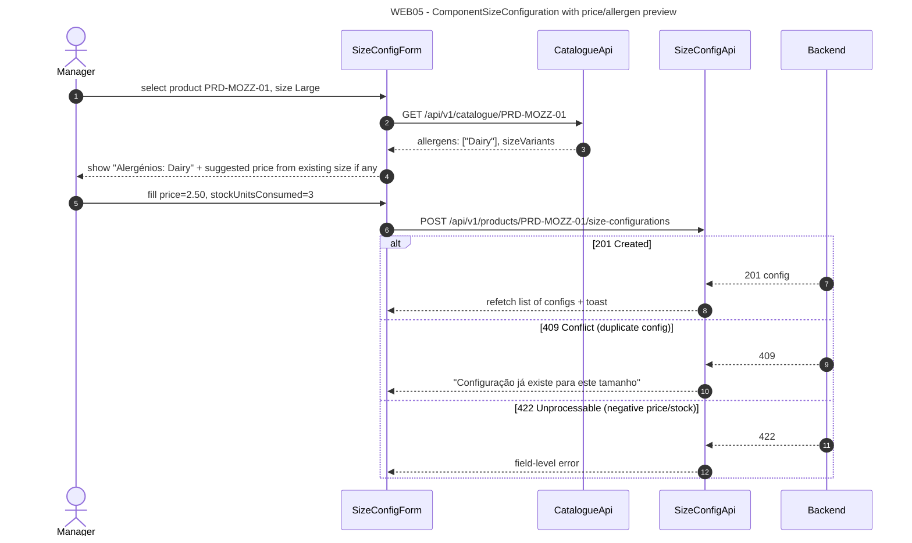
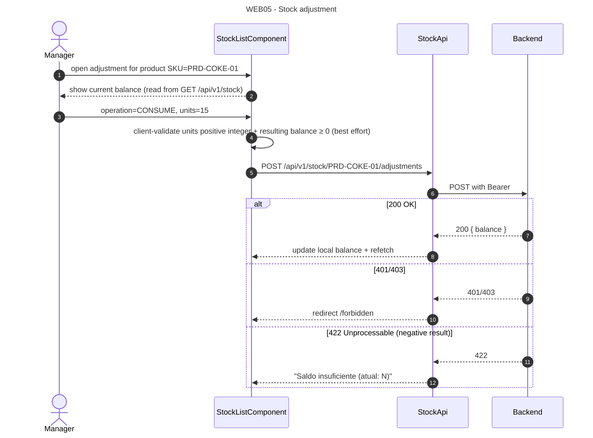
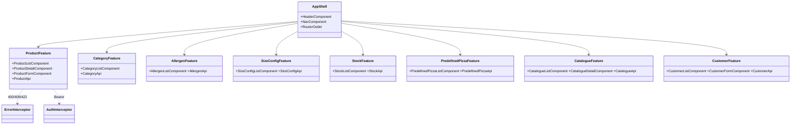

# WEB05 — Sprint 1 Business Management Pages

> **Documentation scope (2026-11-06):** Section 1 preserves the original requirements and proposed design baseline. Section 2 records the implementation inspected in this repository and takes precedence for current paths, roles, flows and completion claims. Differences are documented as remaining work or implementation departures, not as changes to the original specification.

## 1. Requirements Engineering

### 1.1. User Story Description

As a LaPizza Manager, I want pages for the business capabilities delivered in Sprint 1, so that the existing services are usable through the SPA.

### 1.2. Customer Specifications and Clarifications

#### From the specification document
> Extracted from *PART IV — Sprint 2 — User Stories* (WEB05, p. 6); cross-referenced with *PART III — Sprint 1 — User Stories* (BCK01–BCK11) and *PART II — System Specification* (§II.3.1, §II.3.2).

- **Page scope (mandatory):** customers, product categories, allergens, products, pizza sizes, pizza component types, size-dependent component configurations, stock information, predefined pizzas, and the sellable catalogue.
- **Form + persistence:** Forms validate required data and use the corresponding REST APIs to read and persist information.
- **Search/filter:** Search and filtering follow the relevant Sprint 1 capabilities; existing business invariants remain enforced (e.g., `(isSellable ∨ isPizzaComponent)` for products, `currentUnits ≥ 0` for stock, `assemblyOrder` unique across component types).
- **Allergen exposure:** Product and predefined-pizza views expose relevant allergen information (derived from recipe components for predefined pizzas — BCK11 AC5, Clarification #01 Q5).
- **Non-scope:** No order processing, no personalized-pizza pricing rules, no supplier-management operations beyond WEB07's explicit needs.
- **Permission-aware actions:** Each list and detail view must distinguish available actions according to the user's permissions (WEB03 role guard + visible action buttons).
- **Empty/edge states:** Empty results and unavailable records must be clearly explained.
- **Refresh after change:** Information must be refreshed after a successful change so the displayed result reflects the saved state.
- **Confidentiality:** Customer information and dietary restrictions must only be displayed to users who need them for their authorized responsibilities (Table 1: Manager only; Employee does **not** see customer data).

#### From project clarifications (`docs/domain/client-questions.md`)

- **Clarification #08:** One category per product (mandatory); zero price allowed for direct selling price; products are reactivated via `PATCH /products/{sku}/activate`.
- **Clarification #11:** Product names are **not** unique (business key is `sku`); zero price allowed; deactivating a component softly invalidates predefined pizzas that use it (do not delete); predefined pizza cannot be `isPizzaComponent`.
- **Clarification #12:** Stock is deducted at order confirmation (later sprint); no subcategories; price for a sellable product is its `directSellingPrice`.
- **Clarification #13:** No multipliers — each `(product, size)` has an explicit `price` and integer `stockUnitsConsumed`.
- **Clarification #14:** A product cannot drop `isPizzaComponent` while referenced by a size configuration or a predefined-pizza recipe — `409 Conflict`.
- **Clarification #17:** No soft delete for categories/allergens; `ON DELETE RESTRICT` only; deletion failures return `409 Conflict` listing dependent product SKUs (Clarification #23 §1.2).
- **Clarification #18:** Four base component types (`PCT-DOUGH`, `PCT-SAUCE`, `PCT-CHEESE`, `PCT-TOPPING`) immutable via seed; unique `assemblyOrder`; cardinality changes do not invalidate existing recipes.
- **Clarification #19:** Stock is consultable and adjustable on **inactive** products; filtering by active state allowed.
- **Clarification #22:** UI strings translated; business data not translated except allergen names localised; language preference persists; form state preserved on language change.
- **Clarification #23 §1.1:** Error messages explain reason + link to dependencies. §1.2: listing concise; no wizards required; preview of price and allergens during configuration. §1.3: public catalogue hides stock details. §1.4: search semantics = include-all + exclude-any for components. §6.1: `409 Conflict` on concurrent edit with re-read before re-submit.

### 1.3. Acceptance Criteria (expanded, testable)

#### AC1 — Authorized pages exist for all Sprint 1 capabilities
- AC1.1 The SPA exposes routes: `/customers`, `/product-categories`, `/allergens`, `/products`, `/pizza-sizes`, `/pizza-component-types`, `/products/:sku/size-configurations`, `/stock`, `/predefined-pizzas`, `/catalogue`.
- AC1.2 Each route is reachable from the primary navigation (WEB02) for the roles allowed by Table 1: `MANAGER` all; `EMPLOYEE` read on `/catalogue`, `/products` (read), `/stock` (read), `/pizza-sizes` (read); `CUSTOMER` only `/catalogue`; `Guest` only `/catalogue` (public).
- AC1.3 Each route is protected by a `RoleGuard` (WEB03) and the corresponding backend `RolesGuard` (AA05).

#### AC2 — Forms validate required data and use the corresponding REST APIs
- AC2.1 Every create/edit form validates using typed reactive forms; error messages are field-level (WEB04 AC2).
- AC2.2 Client-side validation mirrors backend `Joi` schemas but is never authoritative; server-side `400`/`422` responses are surfaced (WEB04 AC8).
- AC2.3 Every mutation calls the corresponding endpoint from Appendix A and re-fetches the list/detail on success (refresh requirement, AC7).
- AC2.4 Field-level validation rules match the Sprint 1 contracts (see §1.5.1).

#### AC3 — Search and filtering follow Sprint 1 capabilities
- AC3.1 `/customers` supports `GET /customers?search=` (email, name fragment), as per BCK02.
- AC3.2 `/product-categories`, `/allergens`, `/pizza-sizes`, `/pizza-component-types` support `?search=` (case-insensitive substring).
- AC3.3 `/products` supports `?category=…&allergen=…&componentType=…&name=…` (BCK05 §1.5, combined with AND; partial name).
- AC3.4 `/stock` supports filtering by `active` state (Clarification #19).
- AC3.5 `/catalogue` supports `?category=…&excludeAllergens=…&availableOnly=…` (BCK11 §1.5).

#### AC4 — Allergen exposure
- AC4.1 Product detail view lists allergen names from `ProductResponseDTO.associatedAllergens`.
- AC4.2 Predefined-pizza detail view derives allergens from the union of default recipe-line component allergens (BCK11 AC5) — the frontend must not invent or duplicate this derivation if the backend already computes it in `CatalogueItemResponseDTO.allergens`.
- AC4.3 Allergen names are rendered per current language if a localised table exists (Clarification #22); otherwise the canonical name.

#### AC5 — Permission-aware action visibility
- AC5.1 Create/Edit/Delete/Block/Reactivate/Activate buttons are shown **only** when the current user holds the required role (per Table 1) **and** the backend will accept the call.
- AC5.2 Hiding a button is never the sole defence (WEB03 AC6); the backend still rejects unauthorized calls.
- AC5.3 Employee sees read-only views; no mutation buttons.
- AC5.4 Customer/Guest see only `/catalogue` (and public reads).

#### AC6 — Empty/unavailable states
- AC6.1 Empty list renders an explicit "Nenhum registo encontrado" message with a clear next action (e.g., "Criar primeiro registo") when applicable.
- AC6.2 A `404` on a detail route renders "Registo não encontrado ou não disponível" without leaking existence of hidden records.
- AC6.3 Deactivated products render an "Inativo" badge and offer Reactivate (Manager) / hide (Customer catalogue).

#### AC7 — Refresh after change
- AC7.1 After a successful create/update/delete/activate, the affected list and detail view refetch from the backend.
- AC7.2 Optimistic UI updates are allowed only when the backend response is 2xx; on failure, rollback and show error (WEB04 AC5).

#### AC8 — Customer/dietary confidentiality
- AC8.1 `/customers` and customer detail are only reachable by `MANAGER`; `EMPLOYEE`/`CUSTOMER`/`Guest` are redirected by `RoleGuard`.
- AC8.2 Dietary restrictions are shown on customer detail only, not on the public catalogue.
- AC8.3 User-management pages (`/users`, `/users/:username/role-history`) are reachable only by `MANAGER` (AA06).

### 1.4. Found out Dependencies

**Preceding:**
- WEB01 (shell, HTTP layer, interceptors), WEB02 (layout, i18n), WEB03 (role-based nav + guards), WEB04 (feedback + validation framework).
- All Sprint 1 backend endpoints from BCK01–BCK11 (they exist and are tested per Sprint 1 deliverable).
- AA01 (local auth) or AA02 (external IdP) to obtain a JWT.
- AA05 (backend `RolesGuard` enforcement) — the frontend relies on the backend as authoritative.

**Succeeding:**
- WEB06 depends on `GET /api/v1/products` (to select component products when building kitchen equipment lists if needed) and on the shared page framework.
- WEB07 depends on `GET /api/v1/products` (product picker in forecast entries and supplier offers) and on `GET /api/v1/products/export` (product catalogue JSON export).

### 1.5. Input and Output Data

#### 1.5.1. Field-level validation rules per page

| Page | Field | Rule | Source |
|---|---|---|---|
| `/product-categories` | `name` | required, trimmed, 1–100 chars, unique (case-insensitive) | BCK03 |
| | `description` | required, non-empty | BCK03 |
| `/allergens` | `name` | required, trimmed, 1–100 chars, unique | BCK04 |
| | `description` | optional | BCK04 |
| `/products` | `sku` | required, 2–30 chars, `[A-Z0-9-]`, immutable after creation | BCK05 |
| | `name` | required, 1–100, **not** unique | BCK05, Clarification #11 |
| | `description` | required, non-empty | BCK05 |
| | `categoryName` | required, must exist | BCK05 |
| | `isSellable` | boolean | BCK05 |
| | `isPizzaComponent` | boolean | BCK05 |
| | `isStockControlled` | boolean | BCK05 |
| | `componentTypeName` | required iff `isPizzaComponent`; must exist; must be `null` otherwise | BCK05 AC5 |
| | `directSellingPrice` | `number ≥ 0.00` or `null`; required iff `isSellable` (Clarification #08) | BCK05 |
| | role invariant | `isSellable || isPizzaComponent` must hold | Clarification #06 |
| `/pizza-sizes` | `name` | required, 1–50, unique, immutable after creation | BCK06 |
| `/pizza-component-types` | `code` | required, trimmed, uppercase, ≤ 30, unique, immutable | BCK07 |
| | `name` | required, trimmed, ≤ 50, unique case-insensitive | BCK07 |
| | `assemblyOrder` | positive integer, unique | BCK07 |
| | `minCardinality` | integer ≥ 0 | BCK07 |
| | `maxCardinality` | integer ≥ min **or** `null` | BCK07 |
| `/products/:sku/size-configurations` | `pizzaSize` | required, must exist | BCK08 |
| | `price` | required, `number ≥ 0.00` | BCK08 |
| | `stockUnitsConsumed` | required, integer ≥ 0 | BCK08 |
| | uniqueness | composite `(productSku, pizzaSize)` must not already exist | BCK08 |
| `/stock` adjustment | `operation` | enum `{REPLENISHMENT, CONSUMPTION, ADJUSTMENT}` | BCK09 |
| | `units` | positive integer | BCK09 |
| | resulting balance | `currentUnits ± units ≥ 0` | BCK09 |
| `/predefined-pizzas` | `sellableProductSku` | required, must exist and be a sellable product | BCK10 |
| | `recipeName` | required | BCK10 |
| | `defaultRecipeLines[]` | required; each line `{componentProductSku, defaultQuantity ≥ 1}`; component must be an **active** `isPizzaComponent` product | BCK10 |
| | uniqueness | component SKU appears at most once per recipe | BCK10 |
| | cardinality | each component type's `min`/`max` satisfied across the recipe | BCK10 |
| | `availableSizes[]` | required; each size must exist and each component must have a `ComponentSizeConfiguration` for that size | BCK10 |

#### 1.5.2. Request/response shapes (excerpts)

**CreateProductDTO** (from BCK05):
```json
{
  "sku": "PRD-COKE-01",
  "name": "Coca-Cola 33cl",
  "description": "Refrigerante de cola em garrafa de vidro",
  "categoryName": "Beverages",
  "isSellable": true,
  "isPizzaComponent": false,
  "isStockControlled": true,
  "componentTypeName": null,
  "directSellingPrice": 1.50,
  "stockUnitsPerSale": 1,
  "allergens": []
}
```

**CreateComponentSizeConfigurationDTO** (BCK08):
```json
{
  "pizzaSize": "Large",
  "price": 2.50,
  "stockUnitsConsumed": 3
}
```

**StockAdjustmentDTO** (BCK09):
```json
{ "operation": "CONSUMPTION", "units": 15, "reason": "Kitchen batch #40" }
```

**CreatePredefinedPizzaDTO** (BCK10):
```json
{
  "sellableProductSku": "PRD-PIZZA-MARG",
  "recipeName": "Margherita Classica",
  "defaultRecipeLines": [
    { "componentProductSku": "PRD-DOUGH-TRAD", "defaultQuantity": 1 },
    { "componentProductSku": "PRD-SAUCE-TOM", "defaultQuantity": 1 },
    { "componentProductSku": "PRD-MOZZ-01", "defaultQuantity": 1 }
  ],
  "availableSizes": ["Small", "Medium", "Large"]
}
```

#### 1.5.3. Endpoint-to-page matrix

| Page | Method | Endpoint | Roles | Reference |
|---|---|---|---|---|
| `/customers` | GET | `/api/v1/customers?search=` | MANAGER | BCK02 |
| | POST/PUT/DELETE | `/api/v1/customers`, `/api/v1/customers/{email}` | MANAGER | BCK02 |
| | PUT | `/api/v1/customers/{email}/dietary-restrictions` | MANAGER | BCK02 |
| `/product-categories` | GET | `/api/v1/product-categories` | Public | BCK03 |
| | POST/DELETE | `/api/v1/product-categories`, `/api/v1/product-categories/{name}` | MANAGER | BCK03 |
| `/allergens` | GET | `/api/v1/allergens` | Public | BCK04 |
| | POST/DELETE | `/api/v1/allergens`, `/api/v1/allergens/{name}` | MANAGER | BCK04 |
| `/products` | GET | `/api/v1/products?category&allergen&componentType&name` | MANAGER, EMPLOYEE | BCK05 |
| | GET | `/api/v1/products/{sku}` | Public | BCK05 |
| | POST/PUT/DELETE | `/api/v1/products`, `/api/v1/products/{sku}` | MANAGER | BCK05 |
| | PATCH | `/api/v1/products/{sku}/block`, `/activate` | MANAGER | BCK05 |
| `/pizza-sizes` | GET | `/api/v1/pizza-sizes` | Public | BCK06 |
| | POST/DELETE | `/api/v1/pizza-sizes`, `/api/v1/pizza-sizes/{name}` | MANAGER | BCK06 |
| `/pizza-component-types` | GET | `/api/v1/pizza-component-types?search=` | Public | BCK07 |
| | GET | `/api/v1/pizza-component-types/{id}` | Public | BCK07 |
| | POST/PUT/DELETE | `/api/v1/pizza-component-types` etc. | MANAGER | BCK07 |
| `/products/:sku/size-configurations` | GET | `/api/v1/products/{sku}/size-configurations` | Public | BCK08 |
| | POST/PUT/DELETE | same path | MANAGER | BCK08 |
| `/stock` | GET | `/api/v1/stock?active=` | MANAGER, EMPLOYEE | BCK09 |
| | POST | `/api/v1/stock/{productSku}/adjustments` | MANAGER | BCK09 |
| `/predefined-pizzas` | GET | `/api/v1/predefined-pizzas` | Public | BCK10 |
| | POST | `/api/v1/predefined-pizzas` | MANAGER | BCK10 |
| `/catalogue` | GET | `/api/v1/catalogue?category&excludeAllergens&availableOnly` | Public | BCK11 |
| | GET | `/api/v1/catalogue/{productCode}` | Public | BCK11 |

### 1.6. System Sequence Diagrams (SSD)

#### 1.6.1. Product list with multi-criteria filters (Manager/Employee)



#### 1.6.2. Create a product with role validation



#### 1.6.3. Delete category with dependency detection (Clarification #23 §1.2)



#### 1.6.4. Block/reactivate product (soft delete with cascade effect on predefined pizzas)



#### 1.6.5. Size configuration create with preview (Clarification #23 §1.3)



#### 1.6.6. Stock adjustment (authorization + non-negative invariant)



### 1.7. Other Relevant Remarks

#### 1.7.1. Angular component architecture (shared shell + feature modules)



#### 1.7.2. Persistence backing WEB05 (unchanged from Sprint 1 baseline; see KB §17.1–§17.6)

The WEB05 pages are **read/consume** endpoints over the Sprint 1 schema. No new tables introduced by WEB05. The relevant DB constraints are the ones already enforcing invariants in Sprint 1:

- `chk_products_mandatory_type CHECK (is_sellable OR is_pizza_component)`
- `chk_products_component_role CHECK ((is_pizza_component AND component_type_name IS NOT NULL) OR (NOT is_pizza_component AND component_type_name IS NULL))`
- `chk_products_price_non_negative CHECK (direct_selling_price IS NULL OR direct_selling_price >= 0.00)`
- `chk_stock_items_balance_non_negative CHECK (current_units >= 0)`
- `uq_pizza_component_types_assembly_order UNIQUE (assembly_order)`
- `ON DELETE RESTRICT` on `products.category_name`, `products.component_type_name`, `product_allergens.allergen_name`, `component_size_configurations.product_sku`, `predefined_pizza_recipes.component_product_sku`, `predefined_pizza_recipes.pizza_sku`, `predefined_pizza_available_sizes.pizza_sku`
- `ON DELETE CASCADE` on `product_allergens.product_sku`, `predefined_pizza_recipes.pizza_sku`, `predefined_pizza_available_sizes.pizza_sku` (owned by aggregate)

#### 1.7.3. Error-to-HTTP matrix per page (excerpt)

| Page / Action | Condition | HTTP | UI feedback |
|---|---|---|---|
| Create Product | `sku` already exists | 409 | inline on `sku` field |
| Create Product | neither `isSellable` nor `isPizzaComponent` | 422 | banner "Produto deve ter pelo menos um papel" |
| Create Product | `componentTypeName` set but `isPizzaComponent=false` | 422 | inline on `componentTypeName` |
| Delete Category | referenced by products | 409 | dialog listing dependent SKUs + link to `/products?category=…` |
| Delete Allergen | referenced by product or dietary restriction | 409 | dialog listing dependent product SKUs |
| Delete PizzaSize | referenced by component-size-config or predefined-pizza availability | 409 | dialog listing dependencies |
| Delete ComponentType | referenced by products | 409 | dialog listing dependent SKUs |
| Update Product | removing `isPizzaComponent` while referenced | 409 | dialog "Product is referenced by size configs / recipes" |
| Adjust Stock | resulting balance < 0 | 422 | inline on `units` with current balance |
| Create SizeConfig | composite key exists | 409 | inline on `(product, size)` |
| Create PredefinedPizza | available size missing component config | 422 | inline on `availableSizes` listing missing `(component, size)` pairs |
| Create PredefinedPizza | cardinality breach | 422 | inline on recipe lines listing the offending type |
| Any read | unauthorized role | 403 | redirect `/forbidden` |
| Any write | no token / expired token | 401 | redirect `/login?returnUrl=…` |
| Any write | network error | — | toast "Falha de rede. Tente novamente." (retry-safe; no auto-duplicate) |

#### 1.7.4. Verification (automated + demo)

- **Unit (Jest + TestBed):** each form validator rule in §1.5.1 has at least one positive and one negative test; role gating in templates tested via `@if (user.roles.includes('MANAGER'))`.
- **Integration (Supertest + Angular HttpClientTestingModule):** each page's happy path + one 4xx path.
- **Bruno (already covers BCK01–BCK11):** use as backend contract reference; add SPA-driven E2E tests only if the SPA team chooses Playwright/Cypress (not required by spec).
- **Demo acceptance:** show one create + one edit + one delete-with-409 on categories, one product creation with role combination validation, one stock adjustment that is rejected at the boundary (`422`), and one customer detail view that is blocked for an `EMPLOYEE`.

## 2. Current Implementation — 2026-11-06

### 2.1. Delivered business pages

Management pages live under `/backoffice` and require MANAGER. Resource pages reuse configurable list/form components, while products, pizza recipes and component configurations have dedicated editors. Forms use template-driven `FormsModule` bindings, local validation, busy/error/success states and API responses; they are not typed reactive forms.

Browser API paths below use `/api`, which the development/production proxies strip before forwarding to NestJS.

| Capability | Implemented page | API integration and scope |
|---|---|---|
| Products | `/backoffice/products` | `/api/products`; create/edit, category/search/status filtering, pagination, block/activate and allergen association |
| Product categories | `/backoffice/product-categories` | `/api/categories`; shared resource CRUD; create sends `categoryName` |
| Allergens | `/backoffice/allergens` | `/api/allergens`; shared resource CRUD |
| Pizza sizes | `/backoffice/pizza-sizes` | `/api/pizza-sizes`; shared resource CRUD |
| Component types | `/backoffice/pizza-components` | `/api/pizza-component-types`; assembly order and cardinality fields |
| Size configurations | `/backoffice/component-configurations` | `/api/component-size-configurations`; create/edit/delete, explicit price and stock consumption; update/delete use returned configuration ID |
| Pizza recipes | `/backoffice/pizzas` | `/api/predefined-pizzas`; create/edit, component quantities and size selection |
| Stock | Products editor and orders dashboard | `/api/stock`; product stock display and increase action; Manager dashboard lists zero-stock items |
| Sellable catalogue | Public `/menu` | `/api/catalogue`; search, category and availability filters, product/pizza details, allergens and customization |
| Users | `/backoffice/users` | Paginated `/api/users`, role filters and invitations; Administrator controls roles/deactivation/reactivation |
| Own customer information | `/account` | Contact/address/phone and user-allergen endpoints; not a Manager customer-directory page |

Stock replenishment sends `{adjustmentType: "INCREASE", amount, reason: "Backoffice replenishment"}` to `/api/stock/{sku}/adjustments`. The implemented UI does not offer the full stock-adjustment operation set proposed in §1.5. Product stock and lookup failures have separate feedback; if product persistence succeeds but stock replenishment fails, the UI reports partial success and asks the user to review stock before retrying.

Product allergen editing loads all lookup pages, retains confirmed associations after partial failure and offers lookup retry. Shared lookup services avoid truncating selector options to the first API page. Successful mutations refresh the relevant data; failed writes retain actionable feedback rather than reporting success.

### 2.2. Catalogue and order draft

The public menu reads the backend catalogue and displays allergen/availability information without exposing stock balances. Pizza customization uses product, component-type and size-configuration data to check selection cardinality and calculate the displayed draft price. The cart persists locally, supports quantities/removal, and shows item totals. It is not an authoritative confirmed order; prices and availability require confirmation before submission.

### 2.3. Remaining acceptance gaps

WEB05 is **partially implemented** against its full requirements:

- `/backoffice/customers` manages the commercial BCK02 `Customer` aggregate, separately from customer-role `User` accounts. Manager workflows now cover paginated search, create/update/delete, optional matching account link/unlink, VAT, delivery addresses and allergen-linked dietary restrictions. A delete is rejected when historical orders reference the profile. Dietary data is shown on the individual profile detail only. User-account dietary settings remain a separate flow.
- `/backoffice/stock` exists. Manager can increase or decrease stock; Employee can read it without mutation controls. The list supports active/inactive product filtering. No separate stock correction operation exists beyond the specified adjustment types.
- Employee now has read-only access to the product, stock and pizza-size pages listed in AC1.2. Product filters include category, allergen and component type alongside name/SKU search; the public menu can exclude selected allergens. Manager write operations remain protected in the UI and backend.
- AC3.2 search controls are now connected for product categories, allergens, pizza sizes and component types. Their endpoints already supported case-insensitive substring search; the UI sends the search query and resets pagination. Product, stock and customer searches are already covered by AC3.1/AC3.3/AC3.4 and were not duplicated.
- EN/PT runtime translation and language persistence are now implemented (WEB02); API business names/descriptions remain unchanged.
- Checkout/order submission and live order processing remain pending; the orders screen contains a dashboard shell plus live stock warnings. Kitchen visualization is a placeholder.
- Administrator-only role/status changes and Manager/Administrator user listing/invitations differ from the original Manager-only user-administration design in §1.

### 2.4. Source and verification

**Source:** [backoffice routes](../../../frontend/src/app/backoffice/backoffice.routes.ts), [backoffice API](../../../frontend/src/app/backoffice/core/api/backoffice-api.ts), [resource management](../../../frontend/src/app/backoffice/shared_components/resource-management/resources.ts), [products](../../../frontend/src/app/backoffice/pages/products/products.ts), [menu](../../../frontend/src/app/frontoffice/pages/menu/menu-page.ts), [storefront API](../../../frontend/src/app/frontoffice/core/storefront-api.ts).

**Existing verification:** [backoffice suite](../../../frontend/e2e/backoffice/backoffice.spec.ts) covers product CRUD, resource navigation/contracts, configuration edits, product allergens and user management; [storefront suite](../../../frontend/e2e/frontoffice/storefront.spec.ts) covers catalogue, customization, cart persistence and own-account flows. Browser API mocks verify request contracts and UI behavior, not live persistence or complete acceptance of WEB05.
