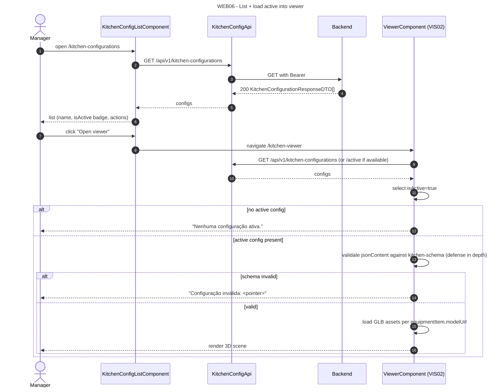
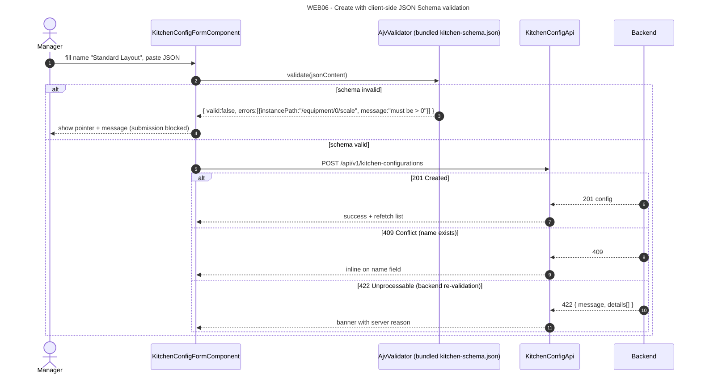
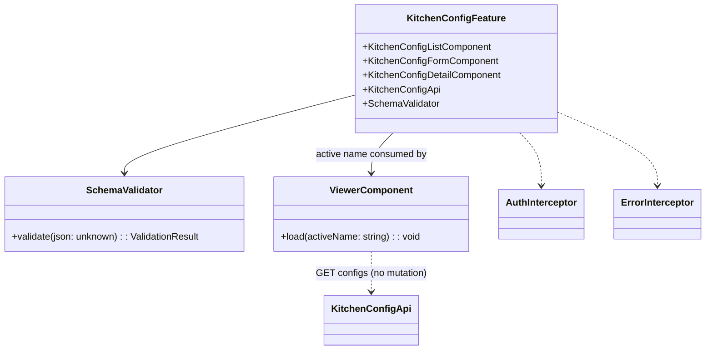

# WEB06 — Kitchen Configuration and 3D Integration Page

## 1. Requirements Engineering

### 1.1. User Story Description

As a LaPizza Manager, I want a website page to manage multiple kitchen configurations in JSON and select the active one, so that the 3D viewer uses the intended kitchen layout.

### 1.2. Customer Specifications and Clarifications

#### From the specification document
> Extracted from *PART IV — Sprint 2 — User Stories* (WEB06, p. 6) and *PART II — System Specification* (§II.3.3.2 Kitchen and Food Preparation Visualization, p. 13).

- **CRUD + activate:** Page accessible to the LaPizza Manager for listing, creating, importing, consulting, editing, and deleting kitchen configurations maintained by the back end.
- **Configuration fields:** unique identifier, descriptive name, JSON content, active/inactive status; **must include kitchen dimensions and the placement, orientation, and scale of equipment and assembly-line elements**.
- **Documented JSON format:** references and visual properties required by VIS, either directly or through resolvable back-end references.
- **Validation:** imported/edited JSON must be validated for syntax, required properties, valid dimensions/scales, unique object identifiers, and valid asset references.
- **Errors:** explained without replacing the last valid configuration.
- **Single-active invariant:** multiple configs stored; **exactly one valid config must be active once the viewer is configured**; activating one deactivates the previous one as a single consistent operation.
- **Delete guard:** active config must not be deleted until a valid replacement has been activated.
- **Viewer consumption:** viewer retrieves the active configuration through a documented back-end endpoint; **must not rely on a layout embedded in the front end**.
- **Post-activation UX:** confirm selected configuration + allow the viewer to reload it. If no active config exists or it cannot be loaded → clear feedback, no silent fallback to another layout.
- **Role restriction:** changes restricted to authorized Managers; other roles view scene where permitted by Table 1.
- **Demo:** at least two distinct valid kitchen configurations, switch active, reject an invalid configuration.

#### From project clarifications and ADRs

- **ADR-011 (KB §5):** Opaque JSONB storage; `name` is the business key (VARCHAR PK); partial unique index `uq_active_kitchen_configuration ON kitchen_configurations (is_active) WHERE is_active = TRUE` enforces the single-active invariant at the DB level; activation uses `UPDATE ... is_active=FALSE` for all rows then `UPDATE ... is_active=TRUE` for target row inside one transaction.
- **ADR-014 (KB §5):** GLTF 2.0 (`.glb`) as exclusive asset format; JSON schema defined by `docs/sg/kitchen-schema.json` (draft 2020-12) with `additionalProperties: false`, `modelUrl` pattern `^/assets/3d/models/.+\.glb$`, structured `$defs` for `dimensions`, `equipmentItem`, `lights` (5 types), `animationTrigger`.
- **`docs/sg/kitchen-layout-example.json`:** reference "Standard Layout" — 6 equipment items + 4 lights + 3 animation triggers, validated against the schema.
- **`docs/sg/3d-assets-guide.md`:** Blender → GLB → Three.js pipeline; performance budget (≤ 5 MB/GLB, ≤ 40 draw calls, ≤ 250k triangles, ≤ 1 shadow-casting light).

### 1.3. Acceptance Criteria (expanded, testable)

#### AC1 — Manager-accessible page exists
- AC1.1 Route `/kitchen-configurations` is reachable only by `MANAGER`.
- AC1.2 `EMPLOYEE` can view the active configuration via the viewer page (VIS02) but has no mutation controls.
- AC1.3 `CUSTOMER`/`Guest` are redirected by `RoleGuard`.

#### AC2 — List, create, import, consult, edit, delete
- AC2.1 List view renders `name`, `isActive`, `createdAt`, `updatedAt`, plus actions per permission (view JSON, edit, delete, activate).
- AC2.2 Create form lets the Manager enter a `name` (business key, immutable after creation) and edit `jsonContent` in a code editor (Monaco or `<textarea>` with syntax highlighting).
- AC2.3 Import action accepts a `.json` file (`<input type="file" accept="application/json">`); the JSON is validated against `docs/sg/kitchen-schema.json` **before** submission.
- AC2.4 View action shows a read-only pretty-printed JSON plus a download button.
- AC2.5 Edit action opens the same editor; a valid replacement replaces the stored content (see AC5 for failure behavior).
- AC2.6 Delete action is disabled when the configuration is active (AC4) or shows a `409` from the backend if the race is lost.

#### AC3 — Required JSON content
- AC3.1 `jsonContent` validates against `docs/sg/kitchen-schema.json` (draft 2020-12) with the following required top-level properties: `dimensions` (`{x, y, z}` positive numbers), `equipment[]` (each `{id (unique string), modelUrl, position [x,y,z], rotation [x,y,z], scale [x,y,z]}`), `lights[]` (`ambient | hemisphere | directional | point | spot`, with `color` hex, `intensity` number; spot also `angle`, `penumbra`), `animationTriggers[]` (array, can be empty in Sprint 2).
- AC3.2 `modelUrl` matches `^/assets/3d/models/.+\.glb$`.
- AC3.3 Every `equipmentItem.id` is unique within the configuration.
- AC3.4 Dimensions, scales, positions, rotations are finite numbers; scales strictly positive.
- AC3.5 `additionalProperties: false` — unknown top-level or per-object properties are rejected.

#### AC4 — Single-active invariant
- AC4.1 At most one row has `is_active = TRUE` (enforced by `uq_active_kitchen_configuration`).
- AC4.2 Activate action calls `POST /api/v1/kitchen-configurations/{name}/activate`; the backend deactivates all others and activates the target in one transaction (ADR-011).
- AC4.3 After activation, list view reflects the new active config (only one row shows `isActive=true`).
- AC4.4 Delete is blocked when `isActive=true` — `409 Conflict` from the backend; UI shows clear reason.
- AC4.5 The first configuration created is **not** automatically active — activation is an explicit action.

#### AC5 — Validation and non-destructive errors
- AC5.1 Client-side validation runs `Ajv` (or equivalent) against `docs/sg/kitchen-schema.json` (bundled in the SPA assets).
- AC5.2 On schema violation, the editor shows the failing JSON pointer and the reason; submission is blocked; the **last valid configuration remains stored** and unchanged.
- AC5.3 On server-side `422` (backend re-validation), the UI shows the error and does not display the invalid content as saved.
- AC5.4 On import of a file larger than the configured budget (e.g., 1 MB), the UI warns and refuses to submit until confirmed.

#### AC6 — Viewer consumes active config from backend (VIS02 contract)
- AC6.1 The 3D viewer (VIS02) fetches the active configuration via `GET /api/v1/kitchen-configurations` and filters `isActive=true` — or via a dedicated `GET /api/v1/kitchen-configurations/active` if the backend exposes one (KB §23 lists only the plural list; the SPA must not hard-code an endpoint that does not exist — verify against OpenAPI before implementation).
- AC6.2 The JSON content is **not** embedded in the SPA bundle; it is always fetched.
- AC6.3 If no active config exists → viewer shows "Nenhuma configuração ativa. Configure uma em /kitchen-configurations." (Manager) / "Configuração de cozinha indisponível." (Employee).
- AC6.4 If the active config fails schema validation on the frontend (defense in depth), the viewer refuses to load and shows the reason; it does **not** fall back to another layout.
- AC6.5 After a successful activation, the page offers a "Reload viewer" button that triggers the viewer to refetch.

#### AC7 — Manager-only mutations
- AC7.1 Create/Edit/Import/Delete/Activate buttons are shown only for `MANAGER`.
- AC7.2 Backend `RolesGuard` enforces the same on every write endpoint.

#### AC8 — Demo readiness
- AC8.1 The repository ships with at least two distinct valid configurations (e.g., `docs/sg/kitchen-layout-example.json` and a second variant) — either seeded via `SEED_DATABASE=true` or importable in the demo.
- AC8.2 Demo flow: import/load two configs, activate config B, verify config A becomes inactive, attempt to delete active config B → 409, attempt to save invalid JSON → 422 with schema error and B still active.

### 1.4. Found out Dependencies

**Preceding:**
- WEB01–WEB04.
- ADR-011 (backend `KitchenConfigurationService.activate` semantics + partial unique index).
- ADR-014 + `docs/sg/kitchen-schema.json` (client-side validation).
- VIS01–VIS02 (viewer consumer; this page's active config is the viewer's input).

**Succeeding:**
- VIS02–VIS07 depend on the active-configuration contract defined here.
- Sprint 3 animation depends on `animationTriggers[]` shape being stable (ADR-014 readiness).

### 1.5. Input and Output Data

#### 1.5.1. DTOs

**CreateKitchenConfigurationDTO:**
```json
{
  "name": "Standard Layout",
  "jsonContent": { /* validated against kitchen-schema.json */ },
  "isActive": false
}
```

**UpdateKitchenConfigurationDTO:** same fields except `name` (immutable) and `isActive` (only changed via `/activate`).

**KitchenConfigurationResponseDTO:**
```json
{
  "name": "Standard Layout",
  "jsonContent": { /* opaque */ },
  "isActive": true,
  "createdAt": "2026-11-05T10:00:00Z",
  "updatedAt": "2026-11-05T10:05:00Z"
}
```

**ActivateKitchenConfigurationRequestDTO:** empty body; `name` is the path parameter.

#### 1.5.2. JSON content contract (excerpt — full schema in `docs/sg/kitchen-schema.json`)

```json
{
  "dimensions": { "x": 10.0, "y": 3.5, "z": 8.0 },
  "equipment": [
    { "id": "oven-main",       "modelUrl": "/assets/3d/models/oven.glb",       "position": [4.0, 0, 6.0], "rotation": [0, 0, 0], "scale": [1, 1, 1] },
    { "id": "conveyor-main",   "modelUrl": "/assets/3d/models/conveyor.glb",   "position": [4.0, 1.1, 3.0], "rotation": [0, 0, 0], "scale": [1, 1, 1] },
    { "id": "counter-receive", "modelUrl": "/assets/3d/models/counter.glb",    "position": [-3.0, 1.0, 3.0], "rotation": [0, 0, 0], "scale": [1, 1, 1] },
    { "id": "arm-01",          "modelUrl": "/assets/3d/models/arm.glb",        "position": [1.0, 1.1, 3.0], "rotation": [0, 1.57, 0], "scale": [1, 1, 1] },
    { "id": "arm-02",          "modelUrl": "/assets/3d/models/arm.glb",        "position": [3.0, 1.1, 3.0], "rotation": [0, 1.57, 0], "scale": [1, 1, 1] },
    { "id": "arm-03",          "modelUrl": "/assets/3d/models/arm.glb",        "position": [5.0, 1.1, 3.0], "rotation": [0, 1.57, 0], "scale": [1, 1, 1] }
  ],
  "lights": [
    { "type": "ambient",    "color": "#ffffff", "intensity": 0.4 },
    { "type": "hemisphere", "skyColor": "#cfe8ff", "groundColor": "#403020", "intensity": 0.3 },
    { "type": "spot",       "position": [4.0, 3.5, 4.0], "target": [4.0, 0, 4.0], "color": "#ffeeaa", "intensity": 1.2, "angle": 0.5, "penumbra": 0.3 },
    { "type": "directional","position": [8.0, 8.0, 4.0], "target": [0, 0, 0], "color": "#ffffff", "intensity": 0.6 }
  ],
  "animationTriggers": [
{
  "id": "conveyor-start",
  "targetEquipmentId": "conveyor-main",
  "action": "loop",
  "loop": true,
  "delay": 0.0
}
  ]
}
```

#### 1.5.3. Endpoint matrix

| Method | Path | Roles | Success | Other |
|---|---|---|---|---|
| GET | `/api/v1/kitchen-configurations` | MANAGER, EMPLOYEE | 200 array | 401, 403 |
| GET | `/api/v1/kitchen-configurations/{name}` | MANAGER, EMPLOYEE | 200 | 404 |
| POST | `/api/v1/kitchen-configurations` | MANAGER | 201 | 400, 401, 403, 409 (name exists), 422 (schema invalid) |
| PUT | `/api/v1/kitchen-configurations/{name}` | MANAGER | 200 | 400, 401, 403, 404, 422 |
| DELETE | `/api/v1/kitchen-configurations/{name}` | MANAGER | 204 | 401, 403, 404, 409 (active) |
| POST | `/api/v1/kitchen-configurations/{name}/activate` | MANAGER | 200 | 401, 403, 404, 422 (schema invalid) |

#### 1.5.4. Persistence (ADR-011 / KB §17.7 / migration 014 §3)

```sql
CREATE TABLE kitchen_configurations (
    name VARCHAR PRIMARY KEY,
    json_content JSONB NOT NULL,
    is_active BOOLEAN NOT NULL DEFAULT FALSE,
    created_at TIMESTAMPTZ NOT NULL DEFAULT NOW(),
    updated_at TIMESTAMPTZ NOT NULL DEFAULT NOW()
);

CREATE UNIQUE INDEX uq_active_kitchen_configuration
    ON kitchen_configurations (is_active)
    WHERE is_active = TRUE;
```

### 1.6. System Sequence Diagrams (SSD)

#### 1.6.1. List configurations and load active into viewer



#### 1.6.2. Create with client-side JSON schema validation



#### 1.6.3. Activate (atomic switch)

```mermaid
sequenceDiagram
autonumber
title WEB06 - Activate configuration atomically
    actor Manager
    participant Page as KitchenConfigListComponent
    participant Dialog as ConfirmDialog
    participant Api as KitchenConfigApi
    participant API as Backend
    participant DB as PostgreSQL

    Manager->>Page: click "Activate" on "Summer Layout"
    Page->>Dialog: open({ title: "Ativar 'Summer Layout'?", message: "A configuração ativa atual será desativada." })
    Manager->>Dialog: confirm
    Dialog->>Api: POST /api/v1/kitchen-configurations/Summer Layout/activate
    Api->>API: POST with Bearer
    API->>DB: BEGIN
    API->>DB: UPDATE kitchen_configurations SET is_active=FALSE WHERE name <> 'Summer Layout'
    API->>DB: UPDATE kitchen_configurations SET is_active=TRUE WHERE name='Summer Layout'
    API->>DB: COMMIT
    alt 200 OK
        API-->>Api: 200
        Api-->>Page: refetch list
        Page-->>Manager: only "Summer Layout" shows isActive=true; toast; "Reload viewer" button visible
    else 404 Not Found
        API-->>Api: 404
        Api-->>Page: "Configuração não encontrada"
    else 422 Unprocessable (schema invalid at activation)
        API-->>Api: 422
        Api-->>Page: banner + previous active config remains active
    end
```

#### 1.6.4. Delete active → 409

```mermaid
sequenceDiagram
autonumber
title WEB06 - Block delete of active configuration
    actor Manager
    participant Page as KitchenConfigListComponent
    participant Api as KitchenConfigApi
    participant API as Backend

    Manager->>Page: click Delete on active config
    Page->>Api: DELETE /api/v1/kitchen-configurations/Summer Layout
    Api->>API: DELETE with Bearer
    alt 409 Conflict (active)
        API-->>Api: 409 { message: "Cannot delete active configuration; activate a replacement first." }
        Api-->>Page: error dialog with hint "Ative outra configuração primeiro"
    else 204 No Content
        API-->>Api: 204
        Api-->>Page: remove from list + toast
    end
```

### 1.7. Other Relevant Remarks

#### 1.7.1. Angular component architecture



#### 1.7.2. Concurrency and invariants

- **Activation atomicity:** Backend performs the two `UPDATE`s inside a `BEGIN ... COMMIT`; the partial unique index guarantees at most one `is_active=TRUE` row even under concurrent activation attempts (one transaction will fail with `23505` and rollback; the API returns `409`).
- **Delete race:** The backend re-checks `isActive` and the DB `NOT NULL`/`is_active` combination; if a concurrent activation races the delete, the DB-level constraint or the service re-check returns `409`.
- **Content replacement:** `PUT` replaces `json_content` entirely (no partial merge). Schema validation runs on the new content; the previous content is preserved on failure (the transaction is not committed).

#### 1.7.3. Error-to-HTTP matrix

| Action | Condition | HTTP | UI feedback |
|---|---|---|---|
| Create | name already exists | 409 | inline on `name` |
| Create/Update | schema invalid (client-side) | — | editor pointer + message; submission blocked |
| Create/Update | schema invalid (server re-validation) | 422 | banner + `details[]` pointers |
| Update | name changed | 422 | inline "name is immutable" |
| Activate | no such config | 404 | toast |
| Activate | schema invalid at activation | 422 | banner; previous active stays active |
| Delete | config is active | 409 | dialog with hint to activate replacement first |
| Delete | config referenced by viewer session (optional future) | 409 | (not in scope for Sprint 2) |
| Any | no token / expired | 401 | redirect `/login?returnUrl=/kitchen-configurations` |
| Any | not MANAGER | 403 | redirect `/forbidden` |

#### 1.7.4. Validation pipeline (defense in depth)

1. **Client-side (SPA):** Ajv (or `ajv-2020` for draft 2020-12) validates against the bundled `docs/sg/kitchen-schema.json`.
2. **Server-side (backend):** `KitchenConfigValidationService` re-validates the same schema before persisting; `422` on failure.
3. **Database:** `json_content JSONB NOT NULL` + partial unique index on `is_active`; no schema constraint on the JSON shape (by design — ADR-011 explicitly keeps the JSON opaque at the DB layer).
4. **Viewer (VIS02):** third validation layer for defense in depth; refuses to render invalid content.

#### 1.7.5. Verification (automated + demo)

- **Unit:** `SchemaValidator` (valid, missing `dimensions`, invalid `modelUrl`, non-positive `scale`, duplicate `equipmentItem.id`) — 5 cases.
- **Integration:** `POST` with invalid JSON → `422`; `POST` with duplicate `name` → `409`; `POST /activate` on valid → `200` and only one `isActive=true`; `DELETE` active → `409`.
- **Concurrency (DB suite):** two simultaneous `POST /activate` calls for different names → exactly one succeeds (200), the other returns `409` from the unique index and rolls back; the DB has exactly one `is_active=TRUE`.
- **Bruno:** already covers WEB06 collection (`backend/tests/bruno/LaPrizza/WEB06-KitchenConfigs/`); ensure the SPA integration tests reuse the same payloads.
- **Demo:** two distinct valid configurations, activate switch, invalid JSON rejection (with reason), delete-active rejection.