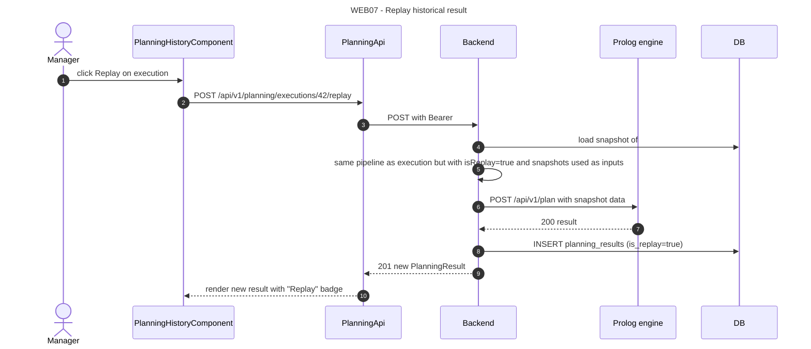
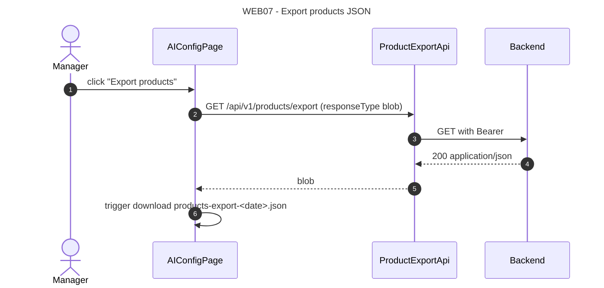
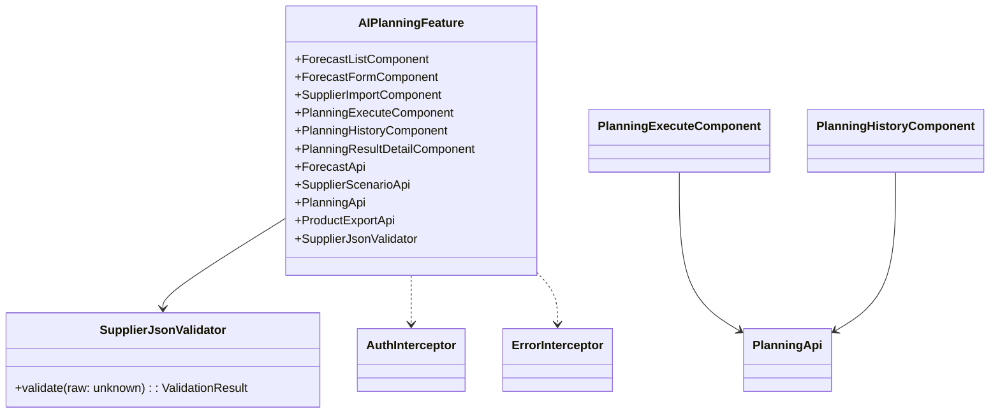

# WEB07 — Artificial Intelligence Configuration and Execution Page

## 1. Requirements Engineering

### 1.1. User Story Description

As a LaPizza Manager, I want a website page to manage daily product-consumption forecasts and prepare supplier data in JSON, so that I can execute and compare planning scenarios using consistent back-end information.

### 1.2. Customer Specifications and Clarifications

#### From the specification document
> Extracted from *PART IV — Sprint 2 — User Stories* (WEB07, pp. 6–8).

- **Forecasts CRUD (Manager only):** create, view, edit, delete `ConsumptionForecast` entries stored in the back end.
- **Forecast shape:** identifier, name, start/end dates, daily quantities of sellable products (including pizzas). Each entry = `{date, product, applicable size, non-negative integer quantity}`.
- **Forecast validation:** reject unknown products, incompatible sizes, dates outside period, duplicate `date/product/size` entries.
- **Zero semantics:** omitted entries mean **zero** consumption — the UI must explain this.
- **Execute forecast:** execute through AI service; consult results; show progress and errors; prevent duplicate submission while in progress.
- **Result association:** each result associated with the forecast version, stock snapshot, pizza BOM, and supplier scenario used.
- **Result content:** daily requirements, suppliers, replenishment, expected delivery dates, unmet needs.
- **Immutability:** editing a forecast must not change the meaning of earlier results.
- **Product export:** export relevant back-end products as JSON — identifiers, names, abstract stock units; include raw materials, purchased aggregates, directly sold stock-controlled products. Selling prices optional.
- **Supplier JSON format:** two lists — suppliers with unique identifiers (names optional), and products with existing system identifiers and a list of supplier offers per product.
- **Offer shape:** supplier id, selling price in EUR, positive integer number of abstract stock units covered, delivery lead time in days from order placement. Prices and lead times non-negative.
- **Supply limits optional** (per offer, per day — per Clarification #28 follow-up).
- **Supplier JSON workflow:** import, inspect, explicitly confirm before saving. Reject invalid structure, duplicates, unknown references, missing required fields, invalid values. Retain previous valid dataset on error.
- **Products without offers visible** as having no configured supplier.
- **Simulated labelling:** manually or LLM-generated offers labelled **simulated**.
- **Confirmed scenarios available to Prolog** through back-end endpoints (AI06).
- **No stock mutation:** forecast executions calculate plans only; must not change stored stock, including scenario input stock. Hypothetical balances and simulated purchase proposals remain scenario results.
- **Demo:** two forecasts with pizza consumption varying over ≥2 days; execution and result consultation; unchanged stored stock. Also product export, supplier import with two offers for one product, rejection of unknown references and missing prices/lead times.

#### From project clarifications (`docs/domain/client-questions.md`)

- **Clarification #26:** Planning is read-only; no purchase order aggregate; `PlanningResult` is read-only; no stock mutation; cancellation out of scope.
- **Clarification #28 (and follow-up):** only pizzas have BOM; explicit `stockUnitsPerSale` per product for `isStockControlled ∧ isSellable`; missing → hard error at planning; first execution rejects inactive references; historical replay uses the original snapshot dataset with `isReplay=true`; lead times = whole days (integer ≥ 0); supply limits per-offer, per-day (not shared across supplier's products); missing limit = unlimited.
- **ADR-012 (KB §5):** Prolog engine runs as a separate container inside the LaPrizza boundary; backend calls `POST http://prolog:8080/api/v1/plan` via `PrologHttpClient`; backend serializes inputs to business-key-oriented JSON (no UUIDs); no direct DB access from Prolog.
- **ADR-013 (KB §5):** `PlanningResult` stores `forecast_snapshot`, `scenario_snapshot`, `stock_snapshot` (deep-copied JSONB), plus `requirements`, `proposals`, `unmet_needs`; FK `forecast_name`/`scenario_name` `ON DELETE SET NULL`; `is_replay` flag for replays.

### 1.3. Acceptance Criteria (expanded, testable)

#### AC1 — Manager-only forecast CRUD
- AC1.1 Route `/ai/forecasts` is reachable only by `MANAGER`.
- AC1.2 `GET /api/v1/consumption-forecasts` lists forecasts with `name`, `startDate`, `endDate`, entry count, `createdAt`, `updatedAt`.
- AC1.3 Create/edit form lets the Manager define `name` (business key, immutable after creation), `startDate`, `endDate`, and a table of `ForecastEntry` rows.
- AC1.4 Delete removes the forecast and cascades entries (`ON DELETE CASCADE` on `consumption_forecast_entries`).

#### AC2 — Forecast entry validation
- AC2.1 Each entry is `{date, productSku, pizzaSize?, quantity}` where:
  - `date ∈ [startDate, endDate]` (inclusive).
  - `productSku` exists in `GET /api/v1/products` and is `sellable=true`.
  - `pizzaSize` is required when the product is a pizza (per business rule); must exist in `GET /api/v1/pizza-sizes`; `null` for non-pizza products.
  - `quantity` is a non-negative integer (`≥ 0`).
- AC2.2 The composite `(date, productSku, pizzaSize)` is unique within the forecast; duplicates are rejected client-side (inline) and server-side (`409 Conflict`).
- AC2.3 Omitted entries explicitly mean **zero** consumption — the UI displays this explanation on the forecast detail page.
- AC2.4 Unknown products, incompatible sizes (a pizza-size applied to a non-pizza product or vice versa), and out-of-range dates are rejected with field-level errors.
- AC2.5 Editing a forecast that has been executed does not modify existing `PlanningResult` rows (immutability via snapshots — AC6).

#### AC3 — Execute forecast and consult results
- AC3.1 Execute action calls `POST /api/v1/planning/executions` with `{forecastName, scenarioName, referenceDate?}`; `referenceDate` defaults to today.
- AC3.2 While the request is in flight, the execute button is disabled and a progress indicator is shown; repeated clicks must not send duplicate requests (Web04 AC3/AC6).
- AC3.3 On success, the UI shows the `PlanningResult` with: `executionId`, `forecastName`, `scenarioName`, `referenceDate`, `isReplay`, `isSimulated`, `executedAt`, `requirements`, `proposals`, `unmetNeeds`.
- AC3.4 On `422 Unprocessable` (missing `stockUnitsPerSale`, inactive reference at first execution), show the actionable error message.
- AC3.5 On `502 Bad Gateway` (Prolog unavailable), show "Serviço de planeamento indisponível" and allow retry.
- AC3.6 History list `GET /api/v1/planning/executions` is paginated and shows the same fields minus full payloads; detail via `GET /api/v1/planning/executions/{executionId}`.
- AC3.7 Replay action calls `POST /api/v1/planning/executions/{executionId}/replay`; the new result carries `isReplay=true` and the snapshots from the original (ADR-013).

#### AC4 — Result-to-input association and immutability
- AC4.1 Result detail shows the forecast name, scenario name, `referenceDate`, and `isSimulated`/`isReplay` badges.
- AC4.2 The result **snapshots** (forecast/scenario/stock) are stored server-side and are not affected by later edits to the forecast or scenario (ADR-013).
- AC4.3 The UI clearly distinguishes "current forecast" (mutable) from "result snapshot" (immutable) — e.g., a note: "Este resultado reflete a versão da previsão no momento da execução."

#### AC5 — Product export for planning
- AC5.1 Export action calls `GET /api/v1/products/export`; response is a JSON file with `products[]` containing `sku`, `name`, `stockUnitsPerSale?`, `isStockControlled`, `isSellable`, `isPizzaComponent`, `categoryName`, `allergens[]`, `isActive`.
- AC5.2 The export includes raw materials, purchased aggregates, and directly sold stock-controlled products (spec filter).
- AC5.3 Selling prices are optional; absence must not exclude the product (spec).
- AC5.4 Download is offered as `products-export-<yyyy-mm-dd>.json`.

#### AC6 — Supplier JSON import, validation, confirm
- AC6.1 Import accepts a JSON file with exactly two top-level arrays: `suppliers[]` and `products[]` (offers grouped per product) — schema documented in `docs/api/supplier-import.schema.json` (or equivalent).
- AC6.2 `suppliers[]` items: `{supplierCode: string, name?: string}`; `supplierCode` unique within the file.
- AC6.3 `products[]` items: `{productSku: string (exists in system), offers: [{supplierCode, priceEur, stockUnitQuantity, leadTimeDays, dailySupplyLimit?}]}`.
- AC6.4 Offer validation:
  - `supplierCode` references a listed supplier.
  - `priceEur` is a non-negative number.
  - `stockUnitQuantity` is a positive integer.
  - `leadTimeDays` is a non-negative integer.
  - `dailySupplyLimit` is `null`/omitted (= unlimited) or a non-negative integer.
- AC6.5 Reject on: invalid structure, duplicate `supplierCode`, duplicate `(supplierCode, productSku)` within a product's offers, unknown `productSku`, unknown `supplierCode` reference, missing required fields, invalid values. Errors are explained; previous valid dataset is retained.
- AC6.6 Products without offers remain visible in the inspection view, marked "Sem fornecedor configurado".
- AC6.7 Manually or LLM-generated offers are labelled **simulated** (`isSimulated=true` at scenario level; the UI shows a badge).
- AC6.8 Import workflow: **import → inspect (side-by-side preview with validation results) → explicit confirm → save**. Saving calls `POST /api/v1/supplier-scenarios` (create) followed by `POST /api/v1/supplier-scenarios/{name}/confirm` (confirm). Scenario is not available to Prolog until `confirm` succeeds.
- AC6.9 On confirm, `confirmedAt` is set; the scenario appears in the execution selector.

#### AC7 — Execution is read-only
- AC7.1 The UI shows a persistent note on the execution page: "O planeamento não altera stock nem cria encomendas."
- AC7.2 After execution, `GET /api/v1/stock` returns identical balances before and after (verified by demo assertion).
- AC7.3 `PlanningResult` is immutable in the UI (no edit/delete buttons).

#### AC8 — Demo readiness
- AC8.1 The repository ships with at least two forecasts (e.g., `Week-45-Forecast`, `Week-46-Forecast`) whose pizza consumption varies over ≥ 2 days.
- AC8.2 Supplier JSON example with two offers for one product is provided (e.g., `docs/api/supplier-import-example.json`).
- AC8.3 Demo script demonstrates: two forecasts varying over time, execution and result consultation, unchanged stock (before/after snapshot), product export download, supplier import with 2 offers for one product, and rejection of (a) unknown references, (b) missing price, (c) missing lead time.

### 1.4. Found out Dependencies

**Preceding:**
- WEB01–WEB04.
- `GET /api/v1/products` and `GET /api/v1/pizza-sizes` (for forecast entry product/size pickers).
- `GET /api/v1/products/export` (product export).
- ADR-012, ADR-013, ADR-011 (Prolog container, immutable results, active config not strictly required by WEB07 but shared infra).
- AI05 (AI service endpoints) and AI06 (back-end data endpoints) — WEB07 consumes them; the endpoints must exist and be authorized.
- Migration 014 §4 (consumption_forecasts, consumption_forecast_entries, supplier_scenarios, suppliers, supplier_offers, planning_results).

**Succeeding:**
- Sprint 3 AI scheduling (not in Sprint 2) may extend `PlanningResult`.
- IARTI technical report (AI04) references this page's endpoints.

### 1.5. Input and Output Data

#### 1.5.1. DTOs

**ConsumptionForecastRequestDTO:**
```json
{
  "name": "Week-45-Forecast",
  "startDate": "2026-11-02",
  "endDate": "2026-11-08",
  "entries": [
    { "date": "2026-11-02", "productSku": "PRD-PIZZA-MARG", "pizzaSize": "Medium", "quantity": 12 },
    { "date": "2026-11-03", "productSku": "PRD-PIZZA-MARG", "pizzaSize": "Medium", "quantity": 18 },
    { "date": "2026-11-02", "productSku": "PRD-COKE-01", "pizzaSize": null, "quantity": 40 }
  ]
}
```

**ConsumptionForecastResponseDTO:** same fields + `createdAt`, `updatedAt`.

**SupplierScenarioRequestDTO:** (backend stores as `supplier_scenarios` + `suppliers` + `supplier_offers`; the SPA posts the same shape as the import file for consistency)
```json
{
  "name": "Autumn-Scenario",
  "isSimulated": true,
  "suppliers": [
    { "supplierCode": "SUP-A", "name": "Mozzarella Co." },
    { "supplierCode": "SUP-B" }
  ],
  "products": [
    {
      "productSku": "PRD-MOZZ-01",
      "offers": [
        { "supplierCode": "SUP-A", "priceEur": 2.10, "stockUnitQuantity": 100, "leadTimeDays": 2, "dailySupplyLimit": 60 },
        { "supplierCode": "SUP-B", "priceEur": 2.30, "stockUnitQuantity": 100, "leadTimeDays": 1, "dailySupplyLimit": null }
      ]
    },
    {
      "productSku": "PRD-TOMATO-01",
      "offers": [
        { "supplierCode": "SUP-A", "priceEur": 1.40, "stockUnitQuantity": 80, "leadTimeDays": 2 }
      ]
    }
  ]
}
```

**PlanningExecutionRequestDTO:**
```json
{ "forecastName": "Week-45-Forecast", "scenarioName": "Autumn-Scenario", "referenceDate": "2026-11-05" }
```

**PlanningResultResponseDTO:** (from KB §24.10)
```json
{
  "executionId": 42,
  "forecastName": "Week-45-Forecast",
  "scenarioName": "Autumn-Scenario",
  "referenceDate": "2026-11-05",
  "isReplay": false,
  "isSimulated": true,
  "executedAt": "2026-11-05T14:30:00Z",
  "requirements": { "PRD-MOZZ-01": { "required": 120, "available": 80, "replenishmentNeed": 40 } },
  "proposals": [
    { "supplierCode": "SUP-A", "productSku": "PRD-MOZZ-01", "quantity": 40, "orderDate": "2026-11-05", "expectedDelivery": "2026-11-07" }
  ],
  "unmetNeeds": []
}
```

**ProductExportDTO** (from `GET /api/v1/products/export`):
```json
{
  "products": [
    { "sku": "PRD-MOZZ-01", "name": "Mozzarella", "stockUnitsPerSale": null, "isStockControlled": true, "isSellable": false, "isPizzaComponent": true, "categoryName": "Cheese", "allergens": ["Dairy"], "isActive": true }
  ]
}
```

#### 1.5.2. Supplier import file contract (excerpt)

```json
{
  "suppliers": [
    { "supplierCode": "SUP-A", "name": "Mozzarella Co." },
    { "supplierCode": "SUP-B" }
  ],
  "products": [
    {
      "productSku": "PRD-MOZZ-01",
      "offers": [
        { "supplierCode": "SUP-A", "priceEur": 2.10, "stockUnitQuantity": 100, "leadTimeDays": 2, "dailySupplyLimit": 60 },
        { "supplierCode": "SUP-B", "priceEur": 2.30, "stockUnitQuantity": 100, "leadTimeDays": 1 }
      ]
    }
  ]
}
```

Constraints enforced at import: see AC6.4/AC6.5.

#### 1.5.3. Endpoint matrix

| Method | Path | Roles | Success | Other |
|---|---|---|---|---|
| GET | `/api/v1/consumption-forecasts` | MANAGER | 200 array | 401, 403 |
| POST | `/api/v1/consumption-forecasts` | MANAGER | 201 | 400, 409 (name), 422 (entry invalid) |
| PUT | `/api/v1/consumption-forecasts/{name}` | MANAGER | 200 | 400, 404, 422 |
| DELETE | `/api/v1/consumption-forecasts/{name}` | MANAGER | 204 | 404 |
| GET | `/api/v1/supplier-scenarios` | MANAGER | 200 array | 401, 403 |
| POST | `/api/v1/supplier-scenarios` | MANAGER | 201 | 400, 409 (name), 422 |
| PUT | `/api/v1/supplier-scenarios/{name}` | MANAGER | 200 | 400, 404, 422 |
| DELETE | `/api/v1/supplier-scenarios/{name}` | MANAGER | 204 | 404, 409 (confirmed and referenced) |
| POST | `/api/v1/supplier-scenarios/{name}/confirm` | MANAGER | 200 | 404, 409 (already confirmed?), 422 (missing offers) |
| POST | `/api/v1/planning/executions` | MANAGER | 201 | 400, 404 (forecast/scenario), 409 (duplicate/reference), 422 (missing stockUnitsPerSale, inactive ref), 502 (Prolog down) |
| GET | `/api/v1/planning/executions` | MANAGER | 200 (paginated) | 401, 403 |
| GET | `/api/v1/planning/executions/{executionId}` | MANAGER | 200 | 404 |
| POST | `/api/v1/planning/executions/{executionId}/replay` | MANAGER | 201 (new result, `isReplay=true`) | 404, 409 (already replayed?), 502 |
| GET | `/api/v1/products/export` | MANAGER | 200 JSON file | 401, 403 |

#### 1.5.4. Persistence (ADR-012/013, KB §17.8, migration 014 §4)

```sql
CREATE TABLE consumption_forecasts (
    name VARCHAR PRIMARY KEY,
    start_date DATE NOT NULL,
    end_date DATE NOT NULL,
    created_at TIMESTAMPTZ NOT NULL DEFAULT NOW(),
    updated_at TIMESTAMPTZ NOT NULL DEFAULT NOW(),
    CONSTRAINT chk_forecast_dates CHECK (start_date <= end_date)
);

CREATE TABLE consumption_forecast_entries (
    forecast_name VARCHAR NOT NULL REFERENCES consumption_forecasts(name) ON DELETE CASCADE,
    entry_date DATE NOT NULL,
    product_sku VARCHAR NOT NULL REFERENCES products(sku) ON DELETE RESTRICT,
    pizza_size VARCHAR REFERENCES pizza_sizes(name) ON DELETE RESTRICT,
    quantity INT NOT NULL CHECK (quantity >= 0),
    PRIMARY KEY (forecast_name, entry_date, product_sku, pizza_size)
);

CREATE TABLE supplier_scenarios (
    name VARCHAR PRIMARY KEY,
    is_simulated BOOLEAN NOT NULL DEFAULT FALSE,
    confirmed_at TIMESTAMPTZ,
    created_at TIMESTAMPTZ NOT NULL DEFAULT NOW()
);

CREATE TABLE suppliers (
    scenario_name VARCHAR NOT NULL REFERENCES supplier_scenarios(name) ON DELETE CASCADE,
    supplier_code VARCHAR NOT NULL,
    name VARCHAR,
    PRIMARY KEY (scenario_name, supplier_code)
);

CREATE TABLE supplier_offers (
    scenario_name VARCHAR NOT NULL,
    supplier_code VARCHAR NOT NULL,
    product_sku VARCHAR NOT NULL REFERENCES products(sku) ON DELETE RESTRICT,
    price_amount NUMERIC(10,2) NOT NULL CHECK (price_amount >= 0),
    price_currency VARCHAR NOT NULL DEFAULT 'EUR',
    stock_unit_quantity INT NOT NULL CHECK (stock_unit_quantity > 0),
    lead_time_days INT NOT NULL CHECK (lead_time_days >= 0),
    daily_supply_limit INT CHECK (daily_supply_limit IS NULL OR daily_supply_limit >= 0),
    PRIMARY KEY (scenario_name, supplier_code, product_sku),
    FOREIGN KEY (scenario_name, supplier_code) REFERENCES suppliers(scenario_name, supplier_code) ON DELETE CASCADE
);

CREATE TABLE planning_results (
    execution_id SERIAL PRIMARY KEY,
    forecast_name VARCHAR REFERENCES consumption_forecasts(name) ON DELETE SET NULL,
    scenario_name VARCHAR REFERENCES supplier_scenarios(name) ON DELETE SET NULL,
    reference_date DATE NOT NULL,
    is_replay BOOLEAN NOT NULL DEFAULT FALSE,
    is_simulated BOOLEAN NOT NULL DEFAULT FALSE,
    forecast_snapshot JSONB NOT NULL,
    scenario_snapshot JSONB NOT NULL,
    stock_snapshot JSONB NOT NULL,
    requirements JSONB NOT NULL,
    proposals JSONB NOT NULL,
    unmet_needs JSONB NOT NULL,
    executed_at TIMESTAMPTZ NOT NULL DEFAULT NOW()
);
```

### 1.6. System Sequence Diagrams (SSD)

#### 1.6.1. Create a forecast with entry validation

```mermaid
sequenceDiagram
autonumber
title WEB07 - Create forecast with entry validation
    actor Manager
    participant Form as ForecastFormComponent
    participant ProductApi as ProductApi
    participant SizeApi as PizzaSizeApi
    participant Api as ForecastApi
    participant API as Backend

    Manager->>Form: name = "Week-45-Forecast", start = 2026-11-02, end = 2026-11-08
    Form->>ProductApi: GET /api/v1/products?sellable=true
    ProductApi-->>Form: products (with sku, isPizzaComponent)
    Form->>SizeApi: GET /api/v1/pizza-sizes
    SizeApi-->>Form: sizes
    Manager->>Form: add entries (date, product, size?, quantity)
    Form->>Form: validate: date ∈ [start,end]; product sellable; size required iff product is pizza; quantity ≥ 0; composite key unique
    alt invalid
        Form-->>Manager: inline field errors
    else valid
        Form->>Api: POST /api/v1/consumption-forecasts
        alt 201 Created
            API-->>Api: 201
            Api-->>Form: refetch list + toast
        else 409 Conflict (name)
            API-->>Api: 409
            Api-->>Form: inline on name
        else 422 Unprocessable (entry invalid, e.g. inactive product)
            API-->>Api: 422 { message, details[] }
            Api-->>Form: banner with reason
        end
    end
```

#### 1.6.2. Import supplier JSON → inspect → confirm

```mermaid
sequenceDiagram
autonumber
title WEB07 - Import supplier JSON, inspect, confirm
    actor Manager
    participant Page as SupplierImportComponent
    participant Validator as SupplierJsonValidator
    participant ProductApi as ProductApi
    participant Api as SupplierScenarioApi
    participant API as Backend

    Manager->>Page: choose file supplier-import.json
    Page->>Validator: parse + validate structure, dupes, refs, prices, lead times
    alt invalid
        Validator-->>Page: errors list (per pointer)
        Page-->>Manager: side-by-side preview (raw + errors); "Confirm" disabled
    else valid
        Page->>ProductApi: GET /api/v1/products
        ProductApi-->>Page: products
        Page->>Page: cross-check productSku references + label products with no offers
        Page-->>Manager: preview (suppliers, offers, "no supplier" products, isSimulated badge)
        Manager->>Page: click "Confirm & save"
        Page->>Api: POST /api/v1/supplier-scenarios { name, isSimulated, suppliers, products }
        alt 201 Created
            API-->>Api: 201
            Api->>API: POST /api/v1/supplier-scenarios/{name}/confirm
            alt 200 OK
                API-->>Api: 200 (confirmedAt set)
                Api-->>Page: mark confirmed; scenario available in execution selector
            else 422 Unprocessable
                API-->>Api: 422
                Api-->>Page: banner (missing offers for a required product, etc.); scenario remains unconfirmed
            end
        else 409 Conflict (name)
            API-->>Api: 409
            Api-->>Page: inline on name
        end
    end
```

#### 1.6.3. Execute planning (Prolog call, no stock mutation)

```mermaid
sequenceDiagram
autonumber
title WEB07 - Execute planning (read-only)
    actor Manager
    participant Page as PlanningExecuteComponent
    participant Api as PlanningApi
    participant API as Backend
    participant Prolog as Prolog engine (separate container)
    participant DB as PostgreSQL

    Manager->>Page: select forecast + scenario + referenceDate, click "Execute"
    Page->>Page: disable button + show spinner
    Page->>Api: POST /api/v1/planning/executions
    Api->>API: POST with Bearer
    API->>DB: read forecast + scenario + stock + BOM definitions
    API->>API: PlanningSnapshotDomainService captures deep copies
    API->>API: validate references active; stockUnitsPerSale present for stock∧sellable
    alt validation fails
        API-->>Api: 422 { message, details[] }
        Api-->>Page: banner + re-enable button
    else validated
        API->>Prolog: POST /api/v1/plan { forecast, scenario, stock, bom } (business keys only)
        alt Prolog responds 200
            Prolog-->>API: 200 { requirements, proposals, unmetNeeds }
            API->>DB: INSERT planning_results (snapshots + outputs)
            API-->>Api: 201 PlanningResultResponseDTO
            Api-->>Page: render result; no stock mutation (stock snapshot preserved in DB)
        else Prolog unreachable/timeout
            Prolog-->>API: 502/503
            API-->>Api: 502 { message }
            Api-->>Page: "Serviço de planeamento indisponível. Tente novamente." + re-enable button
        end
    end
```

#### 1.6.4. Replay a historical result



#### 1.6.5. Product export



### 1.7. Other Relevant Remarks

#### 1.7.1. Angular component architecture



#### 1.7.2. Execution pipeline and immutability guarantees

1. **Backend collects inputs** (forecast, scenario, stock, BOM) and passes them through `PlanningSnapshotDomainService` (deep copy) → snapshots are JSON.
2. **Backend serialises** to a business-key-oriented payload (no UUIDs) and calls `PrologHttpClient` → `POST /api/v1/plan` (ADR-012).
3. **Prolog** computes requirements/proposals/unmet needs and returns JSON.
4. **Backend persists** a single `PlanningResult` row containing snapshots + outputs (ADR-013).
5. **No stock mutation** occurs at any step; `stock_items.current_units` is unchanged before/after (Clarification #26).
6. **Replay** re-runs the same pipeline using the **snapshot** as input (not the current forecast/scenario); the new row has `is_replay=true` and its own snapshots (which are identical to the original's inputs at replay time).

#### 1.7.3. Validation rules summary (client + server)

| Field | Client-side (SPA) | Server-side (Joi + domain) | DB |
|---|---|---|---|
| forecast `name` | required, unique (best-effort) | required, unique | PK |
| `startDate ≤ endDate` | yes | yes | `chk_forecast_dates` |
| entry `date ∈ [start, end]` | yes | yes | (via service check; DB has no cross-table CHECK) |
| `productSku` exists | yes (catalog lookup) | yes | FK RESTRICT |
| `pizzaSize` compatibility | yes (pizza ⇒ required, non-pizza ⇒ null) | yes (Clarification #28) | nullable |
| `quantity ≥ 0` | yes | yes | `CHECK (quantity >= 0)` |
| composite `(date, product, size)` unique | yes | yes | PK |
| supplier `supplierCode` unique | yes | yes | PK of `suppliers` per scenario |
| `(supplierCode, productSku)` unique per product | yes | yes | PK of `supplier_offers` |
| `priceEur ≥ 0` | yes | yes | `CHECK (price_amount >= 0)` |
| `stockUnitQuantity > 0` | yes | yes | `CHECK (stock_unit_quantity > 0)` |
| `leadTimeDays ≥ 0` integer | yes | yes | `CHECK (lead_time_days >= 0)` |
| `dailySupplyLimit` null or ≥ 0 | yes | yes | `CHECK (daily_supply_limit IS NULL OR daily_supply_limit >= 0)` |
| `isSimulated` badge | derived from file/source selection | server sets `is_simulated` | column |

#### 1.7.4. Error-to-HTTP matrix

| Action | Condition | HTTP | UI feedback |
|---|---|---|---|
| Create forecast | duplicate `name` | 409 | inline on `name` |
| Create forecast | entry with inactive product | 422 | banner + `details[]` listing `(date, sku)` |
| Create forecast | entry outside `[start,end]` | 422 | inline on entry row |
| Execute | forecast/scenario not found | 404 | banner |
| Execute | missing `stockUnitsPerSale` for a stock∧sellable product | 422 | banner + `details[]` listing SKUs; "Configure o produto em /products" |
| Execute | inactive reference at first execution | 422 | banner + `details[]` |
| Execute | Prolog unreachable | 502 | banner + retry button |
| Replay | Prolog unreachable | 502 | banner + retry |
| Import supplier | unknown `productSku` | 400/422 | import preview shows pointer; confirm disabled |
| Import supplier | duplicate `(supplierCode, productSku)` | 400/422 | import preview shows pointer |
| Confirm scenario | missing offers for a product the planning needs | 422 | banner |
| Delete confirmed scenario | referenced by a `PlanningResult` | 409 (or `SET NULL` per ADR-013) — the FK `ON DELETE SET NULL` on `planning_results` preserves history; the scenario itself can be deleted, and the historical result remains readable | confirm dialog + note "resultados históricos serão preservados" |
| Any | no token / expired | 401 | redirect `/login?returnUrl=…` |
| Any | not MANAGER | 403 | redirect `/forbidden` |

#### 1.7.5. Non-scope reminders

- No purchase order creation (`PurchaseOrder` aggregate does not exist — Clarification #26).
- No stock mutation from planning (Clarification #26).
- No automatic supplier selection outside the Prolog computation (selection is a Prolog output, not a UI action).
- LLM-assisted supplier preparation is optional; if used, the resulting offers must be labelled **simulated** (AC6.7). The SPA does not call the LLM directly.

#### 1.7.6. Verification (automated + demo)

- **Unit (SPA):** `SupplierJsonValidator` (valid, unknown SKU, duplicate supplierCode, duplicate offer, negative price, missing lead time, missing price) — 7 cases; forecast form validator (date range, pizza-size compatibility, quantity non-negative, composite uniqueness) — 5 cases.
- **Integration (backend):** `POST /api/v1/planning/executions` with missing `stockUnitsPerSale` → `422`; with inactive reference → `422`; with Prolog down (mock) → `502`; on success → `201` with `isReplay=false`, `stock_items` unchanged (assert). Replay → `201` with `isReplay=true` and same snapshots.
- **DB suite:** `consumption_forecast_entries` composite PK rejects duplicates; `supplier_offers` FK to `suppliers` enforces the composite FK; `planning_results` persists snapshots as JSONB (assert round-trip).
- **Bruno:** `WEB07-AIPlanning` collection (KB §28.3) covers the endpoint chain; keep in sync with the SPA payloads.
- **Demo:** two forecasts with varying pizza consumption over ≥ 2 days, execute both, consult results, assert stock unchanged via `GET /api/v1/stock` before/after; export products JSON; import supplier JSON with two offers for one product; demonstrate rejection of (a) unknown `productSku`, (b) missing `priceEur`, (c) missing `leadTimeDays`; show `isSimulated` badge on scenario; show `isReplay` badge after replay.