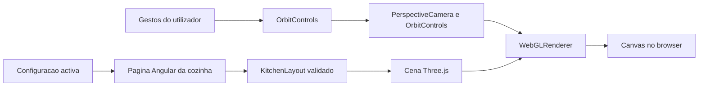

# Guia de defesa SGRAI — Visualização 3D da cozinha

## Foco: VIS07 — interacção com a câmara em perspectiva

Este guia prepara a defesa da componente de SGRAI integrada na SPA LaPrizza. O foco principal é a [VIS07 — Perspective Camera Interaction](../../user-stories/VIS07/requirements.md), que descreve a interacção com a câmara por rato. Para explicar VIS07 com segurança, é preciso primeiro saber de onde vem a configuração, como o componente Three.js é montado e como as histórias VIS01–VIS06 fornecem a cena que a câmara permite inspeccionar.

> **Regra de rigor para a defesa:** distinguir sempre três coisas: o critério da história original, o detalhe acrescentado na especificação expandida da equipa e o comportamento que o código actual prova. Este documento chama a atenção para discrepâncias entre esses níveis; não apresenta propostas de teste como se já tivessem sido executadas.

## Como utilizar este guia

1. Começa pela SPA e pelo percurso da configuração activa.
2. Explica VIS07 a partir dos requisitos originais: alvo no centro do chão, pan à esquerda, órbita à direita e dolly pela roda do rato.
3. Usa o código ligado em cada secção para justificar como o comportamento é conseguido.
4. Termina com as evidências existentes e reconhece as limitações que estão documentadas.

As ligações são relativas ao repositório e abrem os ficheiros directamente. Sempre que um excerto aparece, a ligação para a sua origem está imediatamente antes.

---

# 1. O que é a componente SGRAI nesta aplicação

SGRAI é a visualização tridimensional da cozinha. Não é uma aplicação separada nem um iframe: é um componente Angular dentro do Backoffice. O código usa Three.js para criar uma cena, uma câmara e um renderer WebGL; a SPA continua responsável por rotas, autenticação, navegação e carregamento da configuração.

## 1.1 O modelo mental: cena, câmara e renderer

Em Three.js, estes três objectos têm responsabilidades distintas:

| Objecto | Pergunta que responde | Papel na cozinha |
| --- | --- | --- |
| `Scene` | O que existe no mundo 3D? | Chão, equipamentos, luzes, materiais e objectos carregados de GLB. |
| `PerspectiveCamera` | De que ponto e com que perspectiva se observa o mundo? | Define a vista inicial e muda com pan, órbita e dolly. |
| `WebGLRenderer` | Como converter a cena e a câmara em píxeis? | Cria o canvas e desenha cada frame no browser. |

Uma boa resposta oral é: **“A câmara não cria nem move o equipamento. Ela muda o ponto de vista a partir do qual o renderer projecta a cena.”**

O ciclo conceptual é:



Este fluxo está implementado entre a página [KitchenPage](../../../frontend/src/app/backoffice/pages/kitchen/kitchen-page.ts), o componente [KitchenViewer](../../../frontend/src/app/backoffice/shared_components/kitchen-viewer/kitchen-viewer.ts) e a rota protegida em [backoffice.routes.ts](../../../frontend/src/app/backoffice/backoffice.routes.ts).

## 1.2 Como a visualização entra na SPA

O endereço `/backoffice/kitchen` é filho da rota Backoffice. A rota é lazy-loaded e tem dois níveis relevantes de autorização: `staffGuard` na área Backoffice e `restaurantGuard` na página Kitchen. Isso mantém o utilizador dentro do shell habitual e restringe a visualização a papéis de equipa autorizados.

**Rota e carregamento lazy:** [backoffice.routes.ts](../../../frontend/src/app/backoffice/backoffice.routes.ts)

```typescript
{
  path: 'backoffice',
  canActivate: [staffGuard],
  loadComponent: () => import('./shared_components/layout/backoffice')
    .then((m) => m.Backoffice),
  children: [
    {
      path: 'kitchen',
      canActivate: [restaurantGuard],
      title: 'Kitchen Visualization · Forno',
      loadComponent: () => import('./pages/kitchen/kitchen-page')
        .then((m) => m.KitchenPage),
    },
  ],
}
```

**Porquê lazy-loading:** a cena 3D é uma funcionalidade específica do Backoffice. Carregar a página apenas quando a rota é aberta evita que o arranque normal da SPA tenha de inicializar imediatamente o viewer e as suas dependências. A rota conserva navegação e guardas comuns, sem criar uma segunda aplicação.

Os guards Angular controlam a navegação e a experiência de utilizador. A autorização da API é uma responsabilidade adicional do servidor; uma guarda client-side não substitui validação no Backend.

## 1.3 De onde vem o layout

A página pede ao Backend a configuração marcada como activa. A resposta contém um envelope de configuração; a cena recebe o `jsonContent`, que implementa o tipo `KitchenLayout`.

**Carregamento, validação e passagem ao componente:** [kitchen-page.ts](../../../frontend/src/app/backoffice/pages/kitchen/kitchen-page.ts)

```typescript
constructor() {
  this.loadConfiguration();
  this.viewerSync.listen()
    .pipe(takeUntilDestroyed(this.destroy))
    .subscribe(() => this.loadConfiguration());
}

async loadConfiguration(): Promise<void> {
  this.loading.set(true);
  this.error.set('');

  this.api.activeKitchenConfiguration()
    .pipe(takeUntilDestroyed(this.destroy))
    .subscribe({
      next: async (response) => {
        const validation = await this.kitchenValidator
          .validate(response.jsonContent);
        if (!validation.valid) {
          this.error.set(`Invalid kitchen configuration: ${validation.errors.join(' ')}`);
          return;
        }
        this.configuration.set(response.jsonContent as KitchenLayout);
      },
      error: (e) => this.error.set(errorMessage(e)),
    });
}
```

A página também ouve o serviço [KitchenViewerSyncService](../../../frontend/src/app/backoffice/core/services/kitchen-viewer-sync.service.ts). Uma notificação de alteração leva a página a pedir novamente a configuração activa; a notificação não é usada como fonte dos dados. O contrato entre a gestão WEB06 e o viewer VIS01 está descrito em [WEB06-VIS01-INTEGRATION-CONTRACT.md](../../sg/WEB06-VIS01-INTEGRATION-CONTRACT.md).

Depois da validação, a página passa a configuração ao viewer:

```html
<app-kitchen-viewer [configuration]="configuration()!" />
```

O Backend é a fonte de verdade. A SPA não inventa dimensões, posições nem URLs dos modelos; representa o JSON que foi guardado e validado.

## 1.4 Contrato de dados que afecta a câmara

O contrato relevante para VIS07 é `dimensions`. A câmara usa as dimensões para calcular o centro do chão, a distância inicial e os limites. Os restantes campos preenchem a cena que será observada.

**Tipo consumido pelo viewer:** [KitchenLayout em kitchen-viewer.ts](../../../frontend/src/app/backoffice/shared_components/kitchen-viewer/kitchen-viewer.ts)

```typescript
export interface KitchenLayout {
  schemaVersion: string;
  dimensions: { x: number; y: number; z: number };
  equipment: KitchenEquipment[];
  lights: KitchenLight[];
  animationTriggers?: Array<{
    id: string;
    targetEquipmentId: string;
    [key: string]: unknown;
  }>;
}
```

`x`, `y` e `z` são dimensões do espaço. O chão ocupa o plano X–Z e `y` representa altura. Esta convenção é consistente com o schema [kitchen-schema.json](../../sg/kitchen-schema.json) e com o exemplo [kitchen-layout-example.json](../../sg/kitchen-layout-example.json).

---

# 2. Casos de uso e enquadramento das histórias VIS

O actor indicado pela VIS07 é o Manager. A visualização, no entanto, integra o trabalho diário da cozinha e a rota actual usa `restaurantGuard`, que permite os papéis de restaurante previstos na aplicação. A história da câmara é uma capacidade de consulta da cena, não uma operação de gravação de configuração.

| História | Caso de uso | Relação com VIS07 | Evidência principal |
| --- | --- | --- | --- |
| [VIS01](../../user-stories/VIS01/requirements.md) | Integrar o viewer 3D na SPA e controlar renderer/ciclo de vida | Dá o componente Angular e o canvas no qual a câmara opera. | [KitchenViewer](../../../frontend/src/app/backoffice/shared_components/kitchen-viewer/kitchen-viewer.ts) |
| [VIS02](../../user-stories/VIS02/requirements.md) | Construir sala, chão e equipamento a partir da configuração | Fornece dimensões; VIS07 usa-as para centrar e limitar a câmara. | [schema](../../sg/kitchen-schema.json) e [viewer](../../../frontend/src/app/backoffice/shared_components/kitchen-viewer/kitchen-viewer.ts) |
| [VIS03](../../user-stories/VIS03/requirements.md) | Representar linha de montagem e objectos animados | A câmara permite inspeccionar a linha; não determina a lógica das animações. | [KitchenViewer](../../../frontend/src/app/backoffice/shared_components/kitchen-viewer/kitchen-viewer.ts) |
| [VIS04](../../user-stories/VIS04/requirements.md) | Aplicar materiais, texturas e mapas | A câmara revela o aspecto dos materiais sob diferentes ângulos e distâncias. | [3D assets guide](../../sg/3d-assets-guide.md) |
| [VIS05](../../user-stories/VIS05/requirements.md) | Aplicar iluminação da configuração | A câmara muda o ponto de observação; as luzes ficam no mundo da cena. | [KitchenViewer](../../../frontend/src/app/backoffice/shared_components/kitchen-viewer/kitchen-viewer.ts) |
| [VIS06](../../user-stories/VIS06/requirements.md) | Permitir ajustar luzes através de controlos interactivos | A GUI de luzes ocupa uma sobreposição da página; os seus eventos não substituem a órbita da cena. | [KitchenViewer](../../../frontend/src/app/backoffice/shared_components/kitchen-viewer/kitchen-viewer.ts) |
| **[VIS07](../../user-stories/VIS07/requirements.md)** | **Controlar a câmara com pan, órbita e zoom** | **História em foco: muda a vista, preservando a cena e o seu alvo actual.** | **[OrbitControls e PerspectiveCamera](../../../frontend/src/app/backoffice/shared_components/kitchen-viewer/kitchen-viewer.ts)** |

## 2.1 Dependências funcionais

- Sem [VIS01](../../user-stories/VIS01/requirements.md), não há componente/canvas nem ciclo de renderização onde receber os gestos.
- Sem [VIS02](../../user-stories/VIS02/requirements.md), não há dimensões para determinar o centro do chão nem uma escala apropriada para os limites.
- [VIS03](../../user-stories/VIS03/requirements.md), [VIS04](../../user-stories/VIS04/requirements.md), [VIS05](../../user-stories/VIS05/requirements.md) e [VIS06](../../user-stories/VIS06/requirements.md) enriquecem o conteúdo a inspeccionar, mas não são pré-requisitos matemáticos para mover a câmara.
- A VIS07 não tem uma história sucessora directa indicada no documento; é uma capacidade transversal de navegação da cena.

---

# 3. VIS07: requisitos, comportamento observado e intenção

## 3.1 História em linguagem simples

> Como Manager LaPrizza, quero controlar uma câmara em perspectiva com o rato, para explorar a cena e inspeccionar objectos de ângulos diferentes.

Os comportamentos pedidos são: o alvo inicial no centro do chão; arrastar com o botão esquerdo para fazer pan; arrastar com o botão direito para orbitar em torno do alvo corrente; usar a roda para aproximar/afastar; e manter movimento responsivo, suave e sem jitter ou sensibilidade excessiva.

## 3.2 Critérios e como responder sobre eles

| Critério | Como se demonstra no código actual | Justificação de desenho |
| --- | --- | --- |
| Alvo inicial no centro do chão | `center = (x/2, 0, z/2)` e `controls.target.copy(center)`. | A vista inicial é coerente para cozinhas de dimensões diferentes; não depende de um centro fixo no mundo. |
| Câmara em perspectiva | `new THREE.PerspectiveCamera(45, aspect, 0.1, 1000)`. | Objectos afastados parecem menores; a profundidade é perceptível numa cena espacial. |
| Pan com botão esquerdo | `mouseButtons.LEFT = THREE.MOUSE.PAN`. | A associação é explícita e cumpre a história, que difere do mapeamento habitual do OrbitControls. |
| Órbita com botão direito | `mouseButtons.RIGHT = THREE.MOUSE.ROTATE`; o alvo permanece `controls.target`. | O Manager pode olhar para a cozinha por vários lados sem perder o ponto que escolheu ao fazer pan. |
| Dolly pela roda | `enableZoom = true`; `OrbitControls` aproxima/afasta a câmara ao longo da linha alvo–câmara. | Distância muda sem trocar a lente/fov, o que corresponde a uma aproximação física mais intuitiva. |
| Movimento suave | `enableDamping = true`, `dampingFactor = 0.05` e `controls.update()` por frame. | A entrada do rato converge gradualmente para a posição pretendida. |
| Limites | Distância, raio do alvo e ângulo polar são limitados. | Evita atravessar o chão, ficar dentro de equipamento ou afastar-se sem controlo. |
| Ajuste ao redimensionamento | `ResizeObserver` chama `resize()`, que actualiza aspect ratio, matriz de projecção e tamanho do renderer. | Evita deformar a perspectiva ou manter um canvas com dimensão antiga. |
| Limpeza ao sair | `controls.dispose()` e desligar o ciclo do renderer. | Remove listeners ligados ao canvas e recursos associados ao WebGL. |

Os valores de velocidade e de limites são parâmetros escolhidos pela equipa; a história original não exige números específicos de metros por pixel, graus por arrasto ou distância por clique.

## 3.3 O que não se deve afirmar

- Não existe uma classe `CameraController` no código actual. O documento de requisitos descreve-a como uma proposta de arquitectura; a implementação põe a configuração de `OrbitControls` dentro de `KitchenViewer`.
- A câmara não é guardada entre sessões. Ao reconstruir a configuração, regressa à vista inicial calculada para as dimensões recebidas.
- Pan não translada o equipamento no layout. Altera o alvo de observação e a posição da câmara.
- Dolly não altera o FOV no código; `OrbitControls` move a câmara ao longo do raio para o alvo.
- A suite E2E existente para configurações de cozinha não demonstra gestos de câmara. Essa diferença é detalhada na secção de testes.

---

# 4. Percurso de código de VIS07

## 4.1 O componente Angular e o ponto de ligação ao canvas

`KitchenViewer` é standalone e recebe um `KitchenLayout` obrigatório por `@Input`. Tem um `div` de referência para criar/guardar o canvas do renderer; o HTML não declara um `<canvas>` fixo porque o `WebGLRenderer` cria o elemento.

**Componente, DOM e input:** [kitchen-viewer.ts](../../../frontend/src/app/backoffice/shared_components/kitchen-viewer/kitchen-viewer.ts)

```typescript
@Component({
  selector: 'app-kitchen-viewer',
  standalone: true,
  template: `
    <div class="viewer-wrapper">
      @if (rendererError()) { <p role="alert">{{ rendererError() }}</p> }
      @for (warning of assetWarnings(); track warning) {
        <p role="status">{{ warning }}</p>
      }
      <div #container class="viewer-container"></div>
      <div #guiContainer class="light-gui-container"></div>
    </div>
  `,
})
export class KitchenViewer implements AfterViewInit, OnChanges, OnDestroy {
  @Input({ required: true })
  configuration!: KitchenLayout;

  @ViewChild('container', { static: true })
  private container!: ElementRef<HTMLDivElement>;
}
```

`AfterViewInit` é essencial: o `ElementRef` do contentor precisa de existir antes de se criar o renderer. `OnChanges` trata uma configuração que mude depois da montagem. `OnDestroy` é o ponto em que listeners e recursos gráficos são libertados.

O contentor tem altura limitada por CSS: `clamp(400px, 65vh, 750px)`. Isso dá ao `ResizeObserver` uma área definida e evita que o canvas ocupe altura ilimitada. O CSS está no mesmo [KitchenViewer](../../../frontend/src/app/backoffice/shared_components/kitchen-viewer/kitchen-viewer.ts).

## 4.2 Inicialização da cena e do renderer

Depois de o componente estar no DOM, `ngAfterViewInit` tenta criar a cena. Em seguida reconstrói a cozinha, observa o tamanho do contentor e inicia o ciclo de renderização fora da detecção de alterações Angular.

**Ciclo de vida inicial:** [kitchen-viewer.ts — `ngAfterViewInit`](../../../frontend/src/app/backoffice/shared_components/kitchen-viewer/kitchen-viewer.ts)

```typescript
ngAfterViewInit(): void {
  try {
    this.initializeScene();
  } catch {
    this.rendererError.set('This browser does not support WebGL 2.');
    return;
  }

  this.initialized = true;
  this.rebuildKitchen();

  this.resizeObserver = new ResizeObserver(() => this.resize());
  this.resizeObserver.observe(this.container.nativeElement);

  this.zone.runOutsideAngular(() => this.renderer.setAnimationLoop(() => {
    this.controls.update();
    this.renderer.render(this.scene, this.camera);
    this.updatePerformanceMetrics();
  }));
}
```

### Justificação

- `initializeScene()` cria objectos Three.js quando o contentor já existe.
- `rebuildKitchen()` materializa a configuração recebida: chão, luzes e equipamento.
- `ResizeObserver` responde ao tamanho real do componente, não apenas à janela global.
- `runOutsideAngular()` impede que cada frame, potencialmente dezenas por segundo, provoque detecção de alterações Angular.
- `renderer.setAnimationLoop()` concentra a actualização dos controlos e o desenho da cena no mesmo ciclo.

Há uma chamada adicional a `controls.update()` antes do primeiro render, na inicialização da câmara. Isso aplica imediatamente alvo e orientação inicial, evitando que a primeira imagem use um estado por omissão.

## 4.3 Criação da câmara em perspectiva

**Construção de `PerspectiveCamera` e posição inicial:** [kitchen-viewer.ts — `initializeScene`](../../../frontend/src/app/backoffice/shared_components/kitchen-viewer/kitchen-viewer.ts)

```typescript
const { x, y, z } = this.configuration.dimensions;

this.camera = new THREE.PerspectiveCamera(
  45,
  element.clientWidth / element.clientHeight,
  0.1,
  1000,
);

const center = new THREE.Vector3(
  x / 2,
  0,
  z / 2,
);

const maxDimension = Math.max(x, y, z);
const distance = maxDimension * 1.2;

this.camera.position.set(
  center.x - distance * 0.70,
  center.y + distance * 0.75,
  center.z + distance * 0.85,
);
```

### O significado dos argumentos

`PerspectiveCamera(fov, aspect, near, far)` recebe:

1. **FOV 45°:** abertura vertical da lente. Um FOV menor parece mais aproximado; um maior inclui mais espaço, mas distorce mais as bordas.
2. **Aspect ratio:** largura dividida pela altura do contentor. É recalculado quando o contentor muda de tamanho.
3. **Near 0.1:** objectos demasiado próximos ficam fora do frustum e não são desenhados.
4. **Far 1000 inicialmente:** limite distante provisório. Ao aplicar a configuração, `updateCameraForConfiguration()` substitui-o por `maxDimension * 4` e actualiza a matriz de projecção.

O `center` é o centro do chão, não o centro volumétrico da caixa: `(x/2, 0, z/2)`. Isso segue literalmente o critério de VIS07. Se o chão mede 10 por 8 unidades, o alvo é `(5, 0, 4)`.

### Justificação do ponto de vista inicial

O factor `maxDimension` adapta a vista a layouts pequenos e grandes. A posição inicial fica deslocada para trás, para cima e para um dos lados. A câmara não começa no centro geométrico da cozinha: isso colocaria a câmara dentro da sala/equipamento. Começar fora e olhar para o centro permite ver o chão e os objectos de uma só vez.

Com `D = 1.2 * maxDimension`, o vector relativo ao alvo é `(-0.70D, +0.75D, +0.85D)`. A distância radial é aproximadamente `1.60D`, ou seja, cerca de `1.92 * maxDimension`. Estes coeficientes são valores de composição visual, não requisitos textuais.

## 4.4 `OrbitControls`: uma implementação especializada para a história

Depois de criar o renderer e anexar o seu canvas ao contentor, o componente instancia `OrbitControls` com a câmara e o canvas. O addon fornece captura de ponteiro, cálculos esféricos para órbita, pan, dolly e suporte para damping.

**Instanciação e remapeamento dos botões:** [kitchen-viewer.ts — VIS07 / OrbitControls](../../../frontend/src/app/backoffice/shared_components/kitchen-viewer/kitchen-viewer.ts)

```typescript
this.controls = new OrbitControls(
  this.camera,
  this.renderer.domElement,
);

this.controls.enableDamping = true;
this.controls.dampingFactor = 0.05;
this.controls.enablePan = true;
this.controls.enableRotate = true;
this.controls.enableZoom = true;

this.controls.mouseButtons = {
  LEFT: THREE.MOUSE.PAN,
  MIDDLE: THREE.MOUSE.DOLLY,
  RIGHT: THREE.MOUSE.ROTATE,
};
```

### Porque remapear?

O mapeamento por omissão de `OrbitControls` associa normalmente o botão esquerdo a rodar e o direito a pan. A história pede o contrário: botão esquerdo faz pan e direito orbita. Por isso `mouseButtons` é indispensável; sem ele, a cena podia responder ao rato, mas violaria precisamente a semântica pedida pela história.

O botão do meio fica associado a dolly, além da roda do rato que o controlo já reconhece. O requisito obrigatório refere a roda; o mapeamento do botão do meio é uma capacidade adicional do addon e não deve ser apresentado como o critério principal.

`OrbitControls` é uma classe do addon oficial de Three.js importada no topo do ficheiro `kitchen-viewer.ts`. O componente não calcula manualmente azimute, polar e captura do rato; delega esses pormenores ao controlo, mantendo o código da aplicação centrado na configuração e nos limites.

O addon também trata o evento `contextmenu` no canvas para que o clique direito possa iniciar a órbita sem abrir o menu do browser. A aplicação não implementa um handler de context menu próprio; isto vem do `OrbitControls` que está ligado a `renderer.domElement`.

## 4.5 Pan, órbita e dolly — o que muda geometricamente

### Pan: botão esquerdo

Pan desloca o alvo de observação e a câmara lateralmente, mantendo a orientação relativa. O objecto da cena continua na mesma posição; só a janela de observação se desloca. Isso permite aproximar visualmente uma zona da cozinha sem reescrever o layout.

### Órbita: botão direito

Orbit representa a posição da câmara relativamente ao alvo em coordenadas esféricas. Arrastar à direita muda o ângulo horizontal; arrastar para cima/baixo muda a elevação, dentro dos limites configurados. Como o alvo corrente é `controls.target`, a órbita acompanha um alvo que tenha sido deslocado pelo pan.

### Dolly: roda do rato

Dolly altera o raio entre `camera.position` e `controls.target`. O FOV mantém-se; a posição da câmara desloca-se ao longo da linha que une o alvo à câmara. É por isso que o efeito se sente como aproximar/afastar.

Estes gestos são tratados pelo addon sobre `renderer.domElement`. O código da aplicação não regista manualmente `pointerdown`/`pointermove` para a câmara.

## 4.6 Suavidade, velocidades e limites

**Parâmetros usados pelo código actual:** [kitchen-viewer.ts — limites e velocidades](../../../frontend/src/app/backoffice/shared_components/kitchen-viewer/kitchen-viewer.ts)

```typescript
this.controls.panSpeed = 0.7;
this.controls.rotateSpeed = 0.6;
this.controls.zoomSpeed = 0.8;

this.controls.target.copy(center);
this.controls.minDistance = maxDimension * 0.35;
this.controls.maxDistance = maxDimension * 3;

this.controls.minTargetRadius = 0;
this.controls.maxTargetRadius = maxDimension * 1.5;
this.controls.minPolarAngle = 0.15;
this.controls.maxPolarAngle = Math.PI / 2 - 0.05;

this.controls.update();
```

| Propriedade | Interpretação | Motivo |
| --- | --- | --- |
| `panSpeed = 0.7` | Escala do deslocamento no pan. | Evita que um pequeno movimento do rato atravesse a cozinha inteira. |
| `rotateSpeed = 0.6` | Escala da alteração angular. | Órbita suficientemente responsiva sem rodar demasiado rápido. |
| `zoomSpeed = 0.8` | Escala da mudança de distância. | Reduz zoom agressivo por cada rotação da roda. |
| `minDistance = 0.35 * maxDimension` | Aproximação máxima. | Evita atravessar o alvo e ficar dentro do modelo. |
| `maxDistance = 3 * maxDimension` | Afastamento máximo. | Mantém a cozinha visível e impede perder a cena. |
| `minPolarAngle = 0.15` | Não permite olhar exactamente pelo zénite. | Evita a singularidade de vista vertical e mantém perspectiva útil. |
| `maxPolarAngle = π/2 - 0.05` | Mantém a câmara acima do plano do chão. | Evita orbitar para baixo do chão. |
| `maxTargetRadius = 1.5 * maxDimension` | Limita a excursão do alvo. | Reduz pan ilimitado para longe da cozinha. |

**Nota de precisão sobre `maxTargetRadius`:** no Three.js, o raio do alvo é medido em relação a `controls.cursor`. O código atribui `maxTargetRadius`, mas não muda `controls.cursor`; portanto, o centro dessa limitação continua a ser o cursor por omissão (a origem), e não explicitamente o centro inicial da cozinha. Em cozinhas de referência isto dá uma região utilizável, mas a explicação rigorosa é “limita o alvo em torno do cursor definido pelo OrbitControls”, não “limita exactamente a partir do centro do chão”. Se fosse necessário centrar a restrição na cozinha, seria preciso definir também o cursor para `center` e verificar o comportamento visual.

O `dampingFactor` não é uma velocidade física medida em segundos. É um coeficiente de suavização do addon: o movimento residual converge durante frames seguintes. O ciclo tem de chamar `controls.update()` para a inércia avançar.

## 4.7 O ciclo de renderização é também o ciclo da câmara

**Actualização por frame:** [kitchen-viewer.ts — `setAnimationLoop`](../../../frontend/src/app/backoffice/shared_components/kitchen-viewer/kitchen-viewer.ts)

```typescript
this.zone.runOutsideAngular(() => this.renderer.setAnimationLoop(() => {
  this.controls.update();
  this.renderer.render(this.scene, this.camera);
  this.updatePerformanceMetrics();
}));
```

Ordem do frame:

1. `controls.update()` aplica o gesto pendente e o damping.
2. `renderer.render(scene, camera)` projecta a cena com a nova posição/orientação.
3. Métricas de desempenho são verificadas; o método limita a actualização visual a intervalos de 500 ms.

Se `controls.update()` só fosse chamado quando o utilizador largasse o rato, não haveria uma sequência contínua para o damping; a sensação de movimento suave degradar-se-ia. Se `render()` ocorresse dentro da zona Angular em cada frame, a interface tradicional também sofreria trabalho de change detection desnecessário.

### Como justificar `NgZone`

Three.js tem um ciclo intensivo em frames. Angular não precisa de reavaliar templates em cada frame porque as propriedades da cena são desenhadas directamente no canvas. O código sai da zona Angular para o trabalho gráfico e volta à zona apenas para actualizar sinais de métricas quando necessário. É uma separação de responsabilidades entre renderização imperativa e estado de interface.

## 4.8 Redimensionamento e proporção da imagem

`ResizeObserver` observa o elemento do viewer, não apenas `window.resize`. Ao mudar a largura/altura, o método actualiza `camera.aspect`, chama `updateProjectionMatrix()` e ajusta o tamanho do renderer.

**Código de redimensionamento:** [kitchen-viewer.ts — `resize`](../../../frontend/src/app/backoffice/shared_components/kitchen-viewer/kitchen-viewer.ts)

```typescript
private resize(): void {
  if (!this.renderer || !this.camera) return;

  const element = this.container.nativeElement;
  const width = element.clientWidth;
  const height = element.clientHeight;
  if (!width || !height) return;

  this.camera.aspect = width / height;
  this.camera.updateProjectionMatrix();
  this.renderer.setSize(width, height);
}
```

O `return` para dimensões zero evita divisão por zero e evita criar um canvas sem área útil durante transições de layout. A actualização da matriz é necessária porque alterar `aspect` sozinho não recalcula a projecção que a GPU utiliza.

## 4.9 Quando a configuração activa muda

Quando o `@Input configuration` muda, Angular chama `ngOnChanges`. Se a cena já estiver montada, `rebuildKitchen()` invalida carregamentos GLB antigos, limpa objectos e controlos anteriores da cena, actualiza a câmara para as dimensões novas e monta de novo os elementos. O alvo regressa ao centro do novo chão.

**Reconstrução e actualização da câmara:** [kitchen-viewer.ts — `ngOnChanges`, `rebuildKitchen`, `updateCameraForConfiguration`](../../../frontend/src/app/backoffice/shared_components/kitchen-viewer/kitchen-viewer.ts)

```typescript
ngOnChanges(changes: SimpleChanges): void {
  if (changes['configuration'] && this.initialized) {
    this.rebuildKitchen();
  }
}

private updateCameraForConfiguration(): void {
  const { x, y, z } = this.configuration.dimensions;
  const center = new THREE.Vector3(x / 2, 0, z / 2);
  const maxDimension = Math.max(x, y, z);
  const distance = maxDimension * 1.2;

  this.camera.position.set(
    center.x - distance * 0.70,
    distance * 0.75,
    center.z + distance * 0.85,
  );
  this.camera.near = 0.1;
  this.camera.far = maxDimension * 4;
  this.camera.updateProjectionMatrix();
  this.controls.target.copy(center);
  this.controls.minDistance = maxDimension * 0.35;
  this.controls.maxDistance = maxDimension * 3;
  this.controls.maxTargetRadius = maxDimension * 1.5;
}
```

O método reaplica as dimensões relevantes quando há um layout novo. O FOV não é alterado; só se ajusta o `far` e os limites dimensionais. A vista volta ao enquadramento inicial para garantir que o novo layout começa visível.

## 4.10 Saída da rota e libertação de recursos

O viewer tem de desfazer não só elementos DOM, mas também recursos da GPU e listeners ligados ao canvas. A desmontagem pára o animation loop, termina o observer, liberta os controlos e renderer, perde o contexto WebGL e remove o canvas.

**Limpeza:** [kitchen-viewer.ts — `ngOnDestroy`](../../../frontend/src/app/backoffice/shared_components/kitchen-viewer/kitchen-viewer.ts)

```typescript
ngOnDestroy(): void {
  this.initialized = false;
  this.languageChangeSubscription?.unsubscribe();
  this.modelLoadVersion++;

  this.lightGui?.destroy();
  this.renderer?.setAnimationLoop(null);
  this.resizeObserver?.disconnect();
  this.controls?.dispose();

  if (this.scene) this.disposeSceneObjects();

  this.renderer?.dispose();
  this.renderer?.forceContextLoss();
  this.renderer?.domElement.remove();
  this.guiContainer?.nativeElement.replaceChildren();
}
```

`controls.dispose()` é particularmente importante para VIS07: o addon associa listeners de rato/roda/context menu ao elemento DOM. Sem dispose, sair e entrar repetidamente na rota poderia deixar handlers duplicados ou referências a componentes já destruídos.

---

# 5. Como VIS07 se integra com VIS01–VIS06

Esta secção evita a pergunta “a câmara está a mostrar exactamente o quê?”

## 5.1 VIS01 — o viewer é parte da SPA

VIS01 estabelece a integração como componente, com o shell Angular, autenticação e navegação preservados. O `KitchenViewer` cria o canvas dentro do contentor da página. A câmara e os seus controlos vivem no mesmo componente que gere o renderer.

**Evidência:** [VIS01 requisitos](../../user-stories/VIS01/requirements.md) · [rotas Backoffice](../../../frontend/src/app/backoffice/backoffice.routes.ts) · [componente viewer](../../../frontend/src/app/backoffice/shared_components/kitchen-viewer/kitchen-viewer.ts).

## 5.2 VIS02 — dimensões e colocação do equipamento

VIS02 define cozinha configurável, equipamento, posições e dimensões. VIS07 deriva o centro `(x/2, 0, z/2)` das dimensões em vez de assumir um layout único. Essa escolha permite usar a mesma lógica da câmara com outra configuração activa.

**Evidência:** [VIS02 requisitos](../../user-stories/VIS02/requirements.md) · [schema](../../sg/kitchen-schema.json) · [contrato de integração WEB06/VIS01](../../sg/WEB06-VIS01-INTEGRATION-CONTRACT.md).

## 5.3 VIS03 — linha de montagem e animação

VIS03 coloca os elementos da linha e os triggers no mundo 3D. VIS07 apenas muda o ponto de vista para inspeccionar esses elementos. As animações pertencem ao modelo/scene update, não à câmara.

**Evidência:** [VIS03 requisitos](../../user-stories/VIS03/requirements.md) · [KitchenViewer](../../../frontend/src/app/backoffice/shared_components/kitchen-viewer/kitchen-viewer.ts).

## 5.4 VIS04 — materiais e texturas

VIS04 determina materiais/texturas; `PerspectiveCamera` não calcula mapas UV nem shading. A relação funcional é observacional: órbita e dolly permitem ao Manager apreciar superfícies de vários ângulos e distâncias.

**Evidência:** [VIS04 requisitos](../../user-stories/VIS04/requirements.md) · [guia de assets 3D](../../sg/3d-assets-guide.md).

## 5.5 VIS05 — iluminação

As luzes são objectos da cena em coordenadas de mundo. A câmara desloca-se; luzes e equipamento ficam no sítio. Por isso a mesma alteração de câmara pode mudar quais faces recebem luz, mas não altera as propriedades ou a posição da luz.

**Evidência:** [VIS05 requisitos](../../user-stories/VIS05/requirements.md) · [KitchenViewer — criação de luzes](../../../frontend/src/app/backoffice/shared_components/kitchen-viewer/kitchen-viewer.ts).

## 5.6 VIS06 — interface de iluminação sobreposta

VIS06 usa `lil-gui` para alterar luzes. A GUI é anexada ao `guiContainer` e posicionada por CSS no canto superior direito; o canvas ocupa o contentor inteiro. Esta separação deixa VIS07 gerir o canvas e VIS06 gerir o painel, embora deva ser testado visualmente que o painel não consome eventos de rato destinados ao canvas.

**Evidência:** [VIS06 requisitos](../../user-stories/VIS06/requirements.md) · [KitchenViewer — GUI e estilo](../../../frontend/src/app/backoffice/shared_components/kitchen-viewer/kitchen-viewer.ts).

---

# 6. Verificação: o que está automatizado e o que falta demonstrar

## 6.1 Testes que existem no repositório

O teste E2E [kitchen-configurations.spec.ts](../../../frontend/e2e/backoffice/kitchen-configurations.spec.ts) cobre a gestão WEB06: valida configurações de exemplo com o schema oficial, confirma que os GLB referenciados existem, exercita listagem/pesquisa/criação/edição/activação e impede apagar a configuração activa.

Esse teste sustenta a cadeia de dados de que o viewer depende: uma configuração válida, com referências a assets presentes, pode ser escolhida como activa. Não testa a posição da câmara, os eventos de rato, damping, limite de órbita, roda do rato nem teardown de `OrbitControls`.

Na pesquisa ao repositório não encontrei um teste unitário ou E2E dedicado a VIS07 que simule arrastar à esquerda/direita, roda do rato ou verifique os valores da câmara. Os critérios de verificação descritos em [VIS07 requirements](../../user-stories/VIS07/requirements.md) são uma lista de verificação proposta; não os apresentes como execução automatizada existente.

## 6.2 Demonstração manual defensável

1. Entrar no Backoffice com papel de restaurante autorizado e abrir `/backoffice/kitchen`.
2. Esperar pelo carregamento da configuração activa e identificar o centro do chão.
3. Arrastar com o botão esquerdo: explicar que o alvo e a câmara se deslocam, sem mover equipamento.
4. Arrastar com o botão direito: explicar que a câmara orbita em torno do alvo actual; o menu de contexto não deve interromper o gesto.
5. Usar a roda para aproximar o forno/equipamento e afastar para voltar à cozinha inteira.
6. Tentar olhar por baixo do chão e afastar indefinidamente: demonstrar os limites.
7. Redimensionar o browser e observar que a proporção continua correcta.
8. Navegar para outra rota e regressar. Explicar que `ngOnDestroy` remove observers/listeners e que uma nova instância do viewer é criada.

Ao apresentar a demonstração, chama-lhe **verificação manual**. A evidência automatizada actual cobre os dados/layout, não as interacções VIS07.

## 6.3 Porque essa distinção importa

- Um teste de schema prova estrutura de configuração, não comportamento gráfico.
- Um teste que verifica que um ficheiro `.glb` existe prova a referência no disco, não que o GPU consiga descodificar e mostrar correctamente o asset.
- Um screenshot confirma um estado visual, mas não prova damping, limpeza de listeners ou operação contínua após várias mudanças de rota.
- Uma futura cobertura forte de VIS07 deveria separar o cálculo de parâmetros da câmara (unitário), inicialização/destruição do componente (integração) e gestos observáveis no browser (E2E com WebGL suportado ou uma camada testável de controlos).

---

# 7. ADRs e decisões que justificam a implementação

## 7.1 [ADR-009 — Angular como framework SPA](../../sad/03-rationale/ADR-009-frontend-framework.md)

**Decisão:** usar Angular + TypeScript para a aplicação e manter funcionalidades em componentes/rotas.

**Relação com SGRAI:** o renderer imperativo Three.js é encapsulado no componente `KitchenViewer`; a página `KitchenPage` gere API, estado loading/error e passa dados; a rota lazy mantém o viewer dentro do shell e dos guards.

**Justificação:** o ciclo de renderização 3D é distinto do ciclo de templates Angular. O código mantém o loop fora da zona Angular e só actualiza sinais de UI para erro/métricas. Isso usa a capacidade de Angular para integração, DI e rotas sem exigir que Angular redesenhe a cena 3D.

**Ressalva:** o ADR menciona forms reactivas tipadas como razão para a escolha. Isso não significa que cada parte do frontend use reactive forms; a gestão do layout e o viewer têm responsabilidades diferentes.

## 7.2 [ADR-011 — configuração da cozinha](../../sad/03-rationale/ADR-011-kitchen-configuration.md)

**Decisão:** representar a configuração operacional da cozinha como dados persistidos que podem ser consultados e activados.

**Relação com VIS07:** a câmara recebe `dimensions` a partir da configuração activa; portanto, trocar o layout troca o centro, enquadramento e limites. A câmara não codifica valores fixos para uma única cozinha.

**Justificação:** dados variáveis em JSON evitam recompilar o frontend para cada disposição. A validação do schema protege o viewer de dimensões/campos mal formados antes de reconstruir a cena.

**Evidência:** [KitchenPage](../../../frontend/src/app/backoffice/pages/kitchen/kitchen-page.ts) · [kitchen-schema.json](../../sg/kitchen-schema.json).

## 7.3 [ADR-014 — pipeline de assets 3D e schema](../../sad/03-rationale/ADR-014-3d-asset-pipeline.md)

**Decisão:** GLTF 2.0 binário (`.glb`) como formato de modelos, acompanhado por schema JSON que define dimensões, equipamento, luzes e triggers.

**Relação com VIS07:** o formato e a pipeline fornecem a cena que a câmara inspecciona. O alvo e os limites dependem das dimensões no mesmo contrato. A câmara não carrega GLB directamente; o componente usa o serviço de assets para carregar os modelos.

**Justificação:** um GLB agrega geometria e materiais/texturas com uma referência única, simplificando carregamento browser e reduzindo dependências de vários ficheiros. Um schema explícito coordena Backend/configuração e frontend/renderer.

**Evidência:** [ADR-014](../../sad/03-rationale/ADR-014-3d-asset-pipeline.md) · [3d-assets-guide.md](../../sg/3d-assets-guide.md) · [KitchenAssetService](../../../frontend/src/app/backoffice/core/services/kitchen-asset.service.ts).

## 7.4 [ADR-016 — identidade UUID da configuração](../../sad/03-rationale/ADR-016-kitchen-configuration-uuid-identity.md)

**Decisão:** cada configuração tem identidade técnica UUID estável, separada do nome editável.

**Relação com VIS07:** indirecta. A página consome a configuração activa seleccionada pelo Backend e passa o seu JSON ao viewer; a câmara trabalha com o conteúdo dimensional e não usa o UUID para calcular vista. A identidade estável permite gerir/activar layouts sem tratar o nome como chave técnica.

**Justificação:** alteração do nome não deve alterar a identidade da configuração; a lógica de câmara deve depender dos dados espaciais e não de nomes de layouts.

**Evidência:** [contrato WEB06/VIS01](../../sg/WEB06-VIS01-INTEGRATION-CONTRACT.md) · [KitchenPage](../../../frontend/src/app/backoffice/pages/kitchen/kitchen-page.ts).

## 7.5 Decisão local de usar `OrbitControls`

Não identifiquei um ADR numerado separado para o uso do addon na VIS07. A especificação expandida da história justifica `OrbitControls`: oferece pan, órbita em torno de um alvo, dolly, damping e limites já testados como biblioteca. O mapeamento LEFT/RIGHT é explicitamente alterado porque o padrão do addon não corresponde ao pedido.

**Como defender a alternativa:** handlers manuais dariam mais controlo, mas obrigariam a implementar captura de ponteiro, conversão de pixels para movimento, matemática esférica, limites e inércia. Como a história coincide com as capacidades do addon, a equipa escolheu uma dependência especializada e personalizou o mapeamento necessário.

---

# 8. Discrepâncias e limites que convém saber antes da defesa

## 8.1 Números diferentes entre SSD e implementação

Na secção expandida de VIS07, o documento refere FOV actual de `45°`, distância derivada de `maxDimension * 1.2`, `minDistance = maxDimension * 0.35` e `maxDistance = maxDimension * 3`. Porém, o SSD mais antigo no mesmo ficheiro usa `PerspectiveCamera(50, ...)`, `minDistance = 1.5` e `maxDistance = 2 * max(dim)`.

O código actual em [kitchen-viewer.ts](../../../frontend/src/app/backoffice/shared_components/kitchen-viewer/kitchen-viewer.ts) confirma `45°` e limites multiplicados por `maxDimension`. Para uma defesa da implementação, apresenta os valores do código e assinala que o SSD está desactualizado; não mistures as duas versões.

## 8.2 `CameraController` é proposta documental, não classe real

A secção de arquitectura de VIS07 propõe uma classe `CameraController` como Pure Fabrication para manter o componente mais fino. No código actual não existe tal ficheiro/classe: as responsabilidades estão nos métodos `initializeScene`, `updateCameraForConfiguration`, `resize` e `ngOnDestroy` de `KitchenViewer`.

Se o professor perguntar por isso, responde: **“O documento regista a separação desejável, mas a implementação entregue ainda mantém a configuração de OrbitControls no componente. A responsabilidade está identificável e poderá ser extraída sem mudar o contrato do `KitchenLayout`.”**

## 8.3 Limite radial e origem

O código define `maxTargetRadius` mas não redefine `controls.cursor`. O limite de raio do addon é relativo ao cursor, que mantém a origem por omissão. Logo, não afirmes que o limite é matematicamente centrado no ponto inicial da cozinha. O alvo inicial, esse sim, é exactamente o centro do chão. Esta diferença está no código e deve ser apresentada como oportunidade de refinamento se o limite precisar de ser relativo ao centro da sala.

## 8.4 Sem testes automáticos específicos dos gestos

Existe evidência automatizada para WEB06/configuração, mas a busca no repositório não encontrou teste específico de VIS07. Explica isso com transparência; usa a demonstração manual como verificação observável, sem lhe chamar cobertura automatizada.

---

# 9. Perguntas prováveis e respostas defensáveis

### “Qual é a diferença entre pan e órbita?”

Pan desloca a câmara e o alvo mantendo a orientação relativa; a janela de observação translada-se. Órbita altera o ângulo da câmara em torno do alvo actual. A implementação associa pan ao botão esquerdo e rotação ao direito.

### “Porque é que o alvo não é a origem?”

Porque o centro da cozinha depende de cada configuração. É calculado por `(dimensions.x / 2, 0, dimensions.z / 2)`, para que uma cozinha de qualquer dimensão comece centrada no seu próprio chão.

### “Porque é PerspectiveCamera e não OrthographicCamera?”

VIS07 chama a funcionalidade de câmara em perspectiva. Perspectiva dá pistas de profundidade e escala visual apropriadas à exploração espacial; uma câmara ortográfica manteria tamanho aparente independente da distância e mudaria o tipo de vista pedido.

### “Porque usar OrbitControls?”

Porque a história pede precisamente pan, órbita em torno de um alvo, dolly, damping e limites. A biblioteca trata eventos e matemática; a aplicação altera botões, velocidades, distâncias e ângulos conforme a história.

### “O que evita que a vista fique debaixo do chão?”

`maxPolarAngle = Math.PI / 2 - 0.05` limita a elevação para a câmara permanecer acima do plano horizontal. Distâncias mínimas/máximas também limitam aproximação e afastamento.

### “Porque chamar `update()` a cada frame?”

Para aplicar a inércia do damping e actualizar a câmara de forma contínua. O ciclo chama `controls.update()` antes de desenhar; por isso o frame usa a pose actualizada.

### “Porque `runOutsideAngular`?”

O renderer actualiza o canvas em cada frame. Não é necessário reexecutar change detection para um canvas desenhado directamente por Three.js. O estado Angular é usado para erros, avisos, opções e métricas, não para cada vértice/frame.

### “A câmara acompanha uma nova configuração?”

Sim. A página recebe a configuração activa; alterações ao input desencadeiam `ngOnChanges` e `rebuildKitchen()`. Esse método recalcula alvo, posição inicial e limites a partir das novas dimensões.

### “A posição da câmara fica guardada?”

Não. O estado não é persistido. Não é critério da história e, ao carregar outro layout, a câmara é reinicializada para um enquadramento coerente com as novas dimensões.

### “Que teste prova que o botão esquerdo faz pan?”

Não há teste automatizado específico de VIS07 encontrado no repositório. O código mostra o mapeamento e a demonstração manual confirma visualmente o gesto; o teste E2E actual cobre configurações WEB06, não a câmara.

### “O que faria como melhoria?”

Extrairia a configuração para uma classe/função testável `CameraController`, colocaria o cursor de `OrbitControls` no centro da cozinha para que o limite radial fosse relativo ao layout, e criaria testes unitários para parâmetros e ciclo de vida, além de um teste E2E de gestos num browser com WebGL.

---

# 10. Guião curto de demonstração oral

> “A VIS07 permite inspeccionar a cozinha sem alterar o layout. A página protegida pede a configuração activa ao Backend, valida o JSON e passa as dimensões ao `KitchenViewer`. O componente cria uma `PerspectiveCamera` e define como alvo o centro do chão, calculado por metade de X e Z. Usa `OrbitControls` ligado ao canvas, mas remapeia os botões: esquerdo faz pan e direito orbita; a roda aproxima e afasta. O alvo e as distâncias são limitados e o damping torna o movimento progressivo. `controls.update()` corre antes de cada render, fora da zona Angular. Quando a configuração muda, o viewer reenquadra a sala; quando saio da rota, descarto controlos, observer, renderer e contexto WebGL. A configuração e os assets têm testes E2E no fluxo WEB06, mas não encontrei teste automatizado dedicado aos gestos VIS07, pelo que estes devem ser demonstrados manualmente.”

---

# 11. Referências directas para preparação

## Requisitos e integração

- [VIS07 — Perspective Camera Interaction](../../user-stories/VIS07/requirements.md)
- [VIS01 — integração do módulo 3D](../../user-stories/VIS01/requirements.md) · [VIS02](../../user-stories/VIS02/requirements.md) · [VIS03](../../user-stories/VIS03/requirements.md) · [VIS04](../../user-stories/VIS04/requirements.md) · [VIS05](../../user-stories/VIS05/requirements.md) · [VIS06](../../user-stories/VIS06/requirements.md)
- [WEB06–VIS01 Integration Contract](../../sg/WEB06-VIS01-INTEGRATION-CONTRACT.md)
- [Kitchen schema](../../sg/kitchen-schema.json) · [kitchen layout example](../../sg/kitchen-layout-example.json) · [3D assets guide](../../sg/3d-assets-guide.md)
- [Knowledge Base — SGRAI graphics/cameras](../../contents/content-knowledge-base.md#50-sgrai--fundamentals-of-3d-computer-graphics-on-the-web) · [Three.js animation](../../contents/content-knowledge-base.md#516-animation) · [camera types](../../contents/content-knowledge-base.md#505-cameras-perspective-vs-orthographic)

## Código e verificação

- [KitchenPage](../../../frontend/src/app/backoffice/pages/kitchen/kitchen-page.ts) · [Backoffice routes/guards](../../../frontend/src/app/backoffice/backoffice.routes.ts)
- [KitchenViewer — cena, câmara, controlos, resize e teardown](../../../frontend/src/app/backoffice/shared_components/kitchen-viewer/kitchen-viewer.ts)
- [KitchenAssetService](../../../frontend/src/app/backoffice/core/services/kitchen-asset.service.ts) · [KitchenViewerSyncService](../../../frontend/src/app/backoffice/core/services/kitchen-viewer-sync.service.ts) · [KitchenConfigValidator](../../../frontend/src/app/backoffice/core/validation/kitchen-config-validator.ts)
- [WEB06 configuration E2E suite](../../../frontend/e2e/backoffice/kitchen-configurations.spec.ts)

## ADRs

- [ADR-009 — Angular frontend framework](../../sad/03-rationale/ADR-009-frontend-framework.md)
- [ADR-011 — kitchen configuration](../../sad/03-rationale/ADR-011-kitchen-configuration.md)
- [ADR-014 — 3D asset pipeline](../../sad/03-rationale/ADR-014-3d-asset-pipeline.md)
- [ADR-016 — kitchen configuration UUID identity](../../sad/03-rationale/ADR-016-kitchen-configuration-uuid-identity.md)

